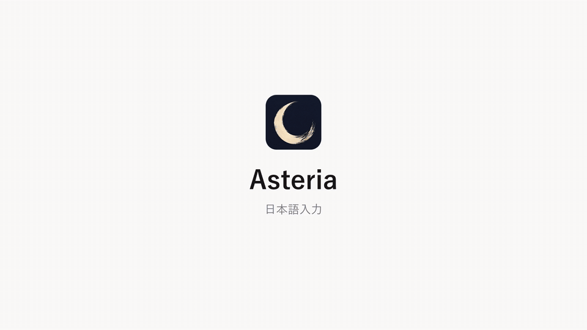

<p align="center">
  <picture>
    <source media="(prefers-color-scheme: dark)" srcset="docs/images/crescent.png">
    
  </picture>
</p>

<h1 align="center">Asteria Japanese Input</h1>

<p align="center">
  <strong>Japanese input that understands context.</strong><br>
  A Windows IME that picks the right kanji from what you have already written.<br>
  Its AI runs entirely on your PC.
</p>

<p align="center">
  <a href="https://github.com/aruiki/Asteria-Japanese-IME/releases/latest"></a>
  
  
  
  
  
</p>


<h3 align="center">
  <a href="https://github.com/aruiki/Asteria-Japanese-IME/releases/latest/download/Asteria-Setup.exe">Download Asteria-Setup.exe</a>
</h3>

<p align="center"><sub>v5.5.0 · Windows 10 / 11 (64-bit) · about 2.1 GB · free · no account needed</sub></p>

---

## The right kanji for the sentence

Many Japanese words share the same reading. Asteria chooses between them by looking at the rest of the sentence.

| You type | One press of Space gives | Meaning |
| :--- | :--- | :--- |
| しょうひんのひんしつをほしょうします | 商品の品質を**保証**します | We *guarantee* the product's quality |
| こくみんのせいかつをほしょうする | 国民の生活を**保障**する | To *secure* people's livelihoods |
| じこのそんがいをほしょうする | 事故の損害を**補償**する | To *compensate* for accident damage |

It also avoids being misled by the previous sentence. After 「口座を開設しました。」 ("I opened an account"), typing にほんごをかいせつ still gives 日本語を解説 ("explain Japanese"), not the 開設 ("open") from the sentence before.

<p align="center">
  <a href="https://aruiki.github.io/kanai/asteria-v3-promo.mp4?v=3.0.0">
    
  </a>
</p>

## Features

- **Works the way you already type.** Text never changes on its own while you type. Space converts, Enter confirms, and Shift+←/→ adjusts segment boundaries. Live conversion is available as an option.
- **Everything stays on your PC.** The dictionary and the AI models run locally. Nothing you type, and no usage data, is ever sent anywhere. Password fields switch to direct input automatically, and nothing is learned in private browsing windows.
- **Fast with a GPU, fine without one.** The AI runs on any Vulkan-capable GPU and uses CUDA automatically on NVIDIA cards. On PCs without a GPU, Asteria switches to a lighter CPU setting.
- **Updates without interruption.** New versions install without closing your apps or restarting Windows.
- **Thoughtful details.** Typo correction, and English spellings such as `github` → `GitHub` (more than 31,000 words).

## Accuracy and speed

Measured with v5.5.0 on the Standard setting, using an NVIDIA GeForce RTX 3060.

| Test set | Questions | Top candidate correct |
| :--- | ---: | ---: |
| Held-out set, never used for tuning (`heldout`) | 300 | 99.0% |
| Long sentences with compounds and rare readings (`ajimee`) | 200 | 95.5% |
| Short everyday sentences (`daily`) | 81 | 100.0% (CUDA) · 98.8% (Vulkan) |
| Practical writing, spelling variants accepted (`usability-multi`) | 120 | 100.0% |
| Homophones (`homophone`) | 40 | 100.0% |
| Idioms and set phrases (`idioms`) | 25 | 100.0% |

For speed, we ran the same procedure against Google Japanese Input / Mozc (v3.34). On the 81 everyday sentences, total time dropped from 15.66 s to 10.63 s, and the slowest single conversion from 847 ms to 167.5 ms.

## Install

1. Download and run [Asteria-Setup.exe](https://github.com/aruiki/Asteria-Japanese-IME/releases/latest/download/Asteria-Setup.exe). If you have an NVIDIA GPU, the CUDA add-on is installed along with it.
2. Press **Windows + Space** and choose **Asteria 日本語入力**.

> [!NOTE]
> The installer is not code-signed, so Windows may show "Windows protected your PC" the first time you run it. Click **More info**, then **Run anyway**. You can check the download against its SHA-256 hash; see the [installation guide](docs/INSTALL.md) (Japanese).

<details>
<summary>System requirements</summary>

| | |
| :--- | :--- |
| OS | Windows 10 (1809 or later) / Windows 11, 64-bit |
| Memory | 8 GB or more (16 GB recommended) |
| Disk space | About 2.0 GB, including the AI models and dictionary |
| GPU (recommended) | A Vulkan-capable GPU with 3 GiB of VRAM or more, or an NVIDIA GPU. Asteria also runs on the CPU alone. |

</details>

<details>
<summary>How it works (for developers)</summary>

Everything from the Windows TSF text service to the dictionary (a double-array trie), the conversion search (Viterbi), learning, the IPC server and the settings UI is written in Rust, across 19 crates. The foundation crates use `#![deny(unsafe_code)]`. Only AI inference uses `llama.cpp` (Vulkan / CUDA).

The AI works in two stages. `Genmai-310M` proposes candidates, and `TinySwallow-1.5B` picks the one that fits the preceding text (up to 256 characters). Every AI candidate is checked against what you typed, and any whose reading does not match is never shown.

```mermaid
flowchart LR
    Key["Keystrokes (Windows TSF)"] --> TIP["asteria-tip-win<br/>(x64 / x86 Rust DLL)"]
    TIP <-->|Named Pipe IPC + ACL| Server["asteria-server<br/>(tokio / state machine)"]
    Server --> Lattice["asteria-dict + asteria-lattice<br/>(double-array trie + Viterbi K-best)"]
    Lattice --> Validate["Reading match + rendaku fallback<br/>+ numeral normalization"]
    Validate --> LM["asteria-lm<br/>(Genmai-310M drafted beam 6<br/>+ TinySwallow-1.5B judge + copy guard)"]
    LM --> Learn["asteria-learn<br/>(context learning + homophone dictionary<br/>+ password-field guard)"]
    Learn --> UI["asteria-renderer / asteria-config<br/>(DirectWrite candidate window / WebView2 UI)"]
```



The system dictionary is built from open-source dictionary data, compiled into a memory-mapped binary by our own compiler, `asteria-dictc`.

### Build and test

```powershell
# Lint and run all tests
just ci

# Build the installers (MSI, CUDA add-on and Setup EXE)
.\frontends\windows\build.ps1 -OutDir target\msi-dist -BuildMsi -BuildBundle -MsiVersion 5.5.0
```

</details>

---

<p align="center"><sub>
  <a href="docs/USER_GUIDE.md">User guide</a>　·　
  <a href="docs/INSTALL.md">Installation, SmartScreen and SHA-256</a>　·　
  <a href="https://aruiki.github.io/kanai/">Project page</a>　·　
  <a href="https://github.com/aruiki/Asteria-Japanese-IME/issues/new/choose">Report a bug or a wrong conversion</a>　·　
  <a href="docs/licenses.md">Licenses</a>
</sub></p>
