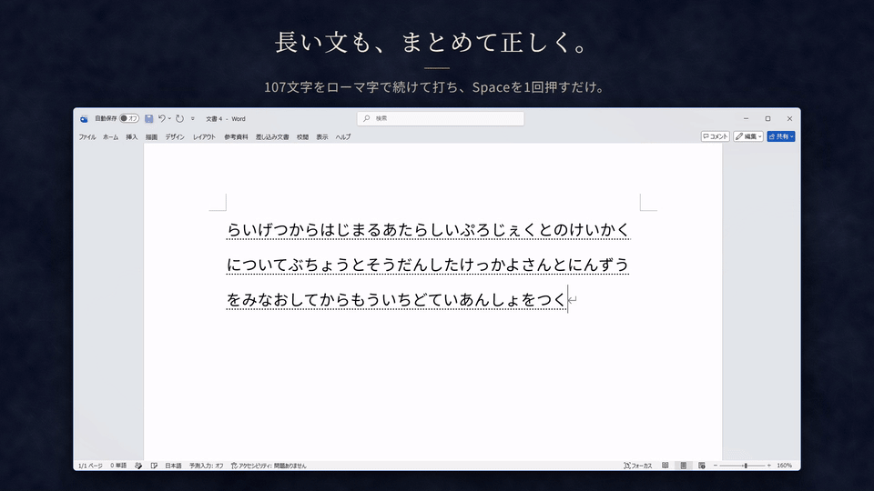

  <picture>
    <source media="(prefers-color-scheme: dark)" srcset="docs/images/crescent.png">
    
  </picture>

<h1 align="center">打ちたい言葉が、Space 1回で。</h1>

変換精度の高い Windows の日本語入力。無料・オープンソース。

  
  

  

<h3 align="center">
  <a href="https://github.com/aruiki/Asteria-Japanese-IME/releases/download/v3.0.0/Asteria64.msi">↓ ダウンロード</a>
</h3>

Windows 10 / 11 · 約1.7 GB · 文章はPCの外へ送りません

 

  <a href="docs/USER_GUIDE.md">使い方</a> ·
  <a href="https://aruiki.github.io/kanai/">公式サイト</a> ·
  <a href="https://github.com/aruiki/Asteria-Japanese-IME/issues/new/choose">不具合の報告</a> ·
  <a href="docs/licenses.md">ライセンス</a>

紹介動画の音楽: 「流るる時」（YouTube オーディオライブラリ）。打鍵音: NCPRIME（Pixabay）。

