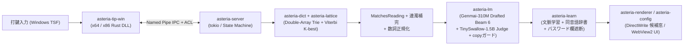

<p align="center">
  <picture>
    <source media="(prefers-color-scheme: dark)" srcset="docs/images/crescent.png">
    
  </picture>
</p>

<h1 align="center">Asteria 日本語入力</h1>

<p align="center">
  <strong>Japanese input that understands context.</strong><br>
  文脈から正しい漢字を選ぶ、Windows 用の日本語入力。<br>
  AI はすべてお使いの PC の中で動きます。
</p>

<p align="center">
  <a href="https://github.com/aruiki/Asteria-Japanese-IME/releases/latest"></a>
  
  
  
  
  
</p>

<p align="center">
  
</p>

<h3 align="center">
  <a href="https://github.com/aruiki/Asteria-Japanese-IME/releases/latest/download/Asteria-Setup.exe">Asteria-Setup.exe をダウンロード</a>
</h3>

<p align="center"><sub>v5.5.0 · Windows 10 / 11（64-bit）· 約 2.1 GB · 無料 · アカウント不要</sub></p>

---

## 文脈に合った漢字を選ぶ

同じ「ほしょう」でも、文に合わせて書き分けます。

| 入力 | Space 1 回で |
| :--- | :--- |
| しょうひんのひんしつをほしょうします | 商品の品質を保証します |
| こくみんのせいかつをほしょうする | 国民の生活を保障する |
| じこのそんがいをほしょうする | 事故の損害を補償する |

前の文にも引きずられません。「口座を開設しました。」のあとに「にほんごをかいせつ」と打てば、「日本語を解説」になります。

<p align="center">
  <a href="https://aruiki.github.io/kanai/asteria-v3-promo.mp4?v=3.0.0">
    
  </a>
</p>

## 特長

- **いつもの操作のまま** — 打っている間に文字が勝手に変わることはありません。Space で変換、Enter で確定、Shift+←→ で文節の長さを変えます。ライブ変換も設定で選べます。
- **すべて手元で** — 辞書も AI も PC の中で動き、入力した文章や利用状況を外へ送りません。パスワード欄では直接入力に切り替わり、プライベートウィンドウでは学習しません。
- **GPU があれば速く、なくても動く** — Vulkan 対応の GPU で AI を動かし、NVIDIA の GPU では CUDA を自動で使います。GPU のない PC では CPU 向けの軽い設定で動きます。
- **止めずに更新** — 新しい版は、アプリを閉じたり PC を再起動したりせずに入れ替えられます。
- **細かなところまで** — 打ち間違いの補正と、`github` → `GitHub` のような英語表記（31,000 語超）に対応します。

## 精度と速さ

v5.5.0 を Standard 設定・NVIDIA GeForce RTX 3060 で測った結果です。

| 評価セット | 問題数 | 第一候補の正解率 |
| :--- | ---: | ---: |
| 調整に使っていない問題（heldout） | 300 | 99.0% |
| 連濁や難読語を含む長文（AJIMEE） | 200 | 95.5% |
| 日常の短い文（daily） | 81 | 100.0%（CUDA）· 98.8%（Vulkan） |
| 表記ゆれを許す実用文（usability-multi） | 120 | 100.0% |
| 同音異義語（homophone） | 40 | 100.0% |
| 慣用句（idioms） | 25 | 100.0% |

速さは、Google 日本語入力 / Mozc（v3.34）と同じ手順で比べました。日常の短い文 81 問の合計は 15.66 秒から 10.63 秒に、いちばん遅かった 1 回は 847 ms から 167.5 ms になっています。

## インストール

1. [Asteria-Setup.exe](https://github.com/aruiki/Asteria-Japanese-IME/releases/latest/download/Asteria-Setup.exe) をダウンロードして実行します。NVIDIA の GPU があれば、CUDA 用の追加分も一緒に入ります。
2. **Windows + Space** で「Asteria 日本語入力」を選びます。

> [!NOTE]
> インストーラには署名がないため、初めて開くときに「Windows によって PC が保護されました」と表示されることがあります。「詳細情報」→「実行」で進めます。配布ファイルは SHA-256 で確かめられます。詳しくは [導入ガイド](docs/INSTALL.md) へ。

<details>
<summary>動作環境</summary>

| 項目 | 条件 |
| :--- | :--- |
| OS | Windows 10（1809 以降）/ Windows 11（64-bit） |
| メモリ | 8 GB 以上（16 GB 推奨） |
| ディスクの空き | 約 2.0 GB（AI モデルと辞書を含む） |
| GPU（推奨） | Vulkan 対応 GPU（VRAM 3 GiB 以上）、または NVIDIA GPU。GPU がなくても CPU で動きます |

本体だけの `Asteria64.msi` と CUDA 用の `AsteriaCuda64.msi` は、[Releases](https://github.com/aruiki/Asteria-Japanese-IME/releases/latest) から個別に入手できます。

</details>

<details>
<summary>しくみ（開発者向け）</summary>

Windows の TSF から、辞書（ダブル配列トライ）、変換の探索（Viterbi）、学習、IPC サーバー、設定画面までを 19 クレートの Rust で書いています。基盤のクレートは `#![deny(unsafe_code)]` です。AI の推論だけ `llama.cpp`（Vulkan / CUDA）を使います。

AI は 2 段階です。`Genmai-310M` が候補を出し、`TinySwallow-1.5B` が前の文（最大 256 文字）に合うものを選びます。AI が出した候補は読みと照らし合わせ、読みが合わないものは表示しません。



システム辞書は、オープンソースの辞書を独自のコンパイラ `asteria-dictc` で mmap 形式に変換したものです。

### ビルドとテスト

```powershell
# リントと全テスト
just ci

# インストーラ（MSI・CUDA 追加分・Setup EXE）をまとめてビルド
.\frontends\windows\build.ps1 -OutDir target\msi-dist -BuildMsi -BuildBundle -MsiVersion 5.5.0
```

</details>

---

<p align="center"><sub>
  <a href="docs/USER_GUIDE.md">使い方と設定ガイド</a>　·　
  <a href="docs/INSTALL.md">導入・SmartScreen・SHA-256 検証</a>　·　
  <a href="https://aruiki.github.io/kanai/">紹介ページ</a>　·　
  <a href="https://github.com/aruiki/Asteria-Japanese-IME/issues/new/choose">不具合・誤変換の報告</a>　·　
  <a href="docs/licenses.md">ライセンス</a>
</sub></p>
