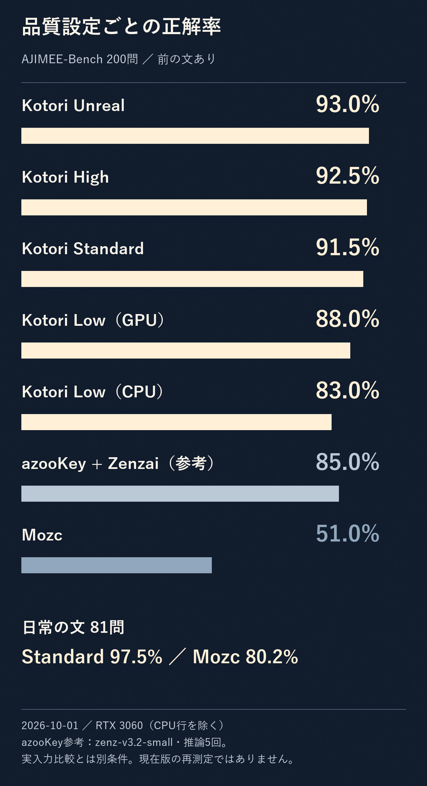
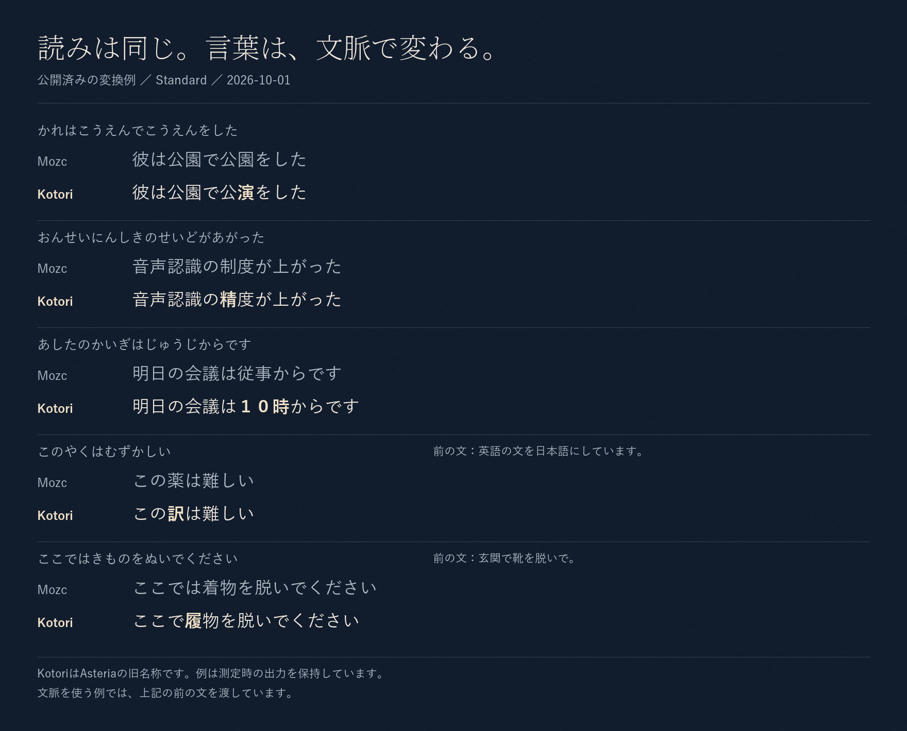
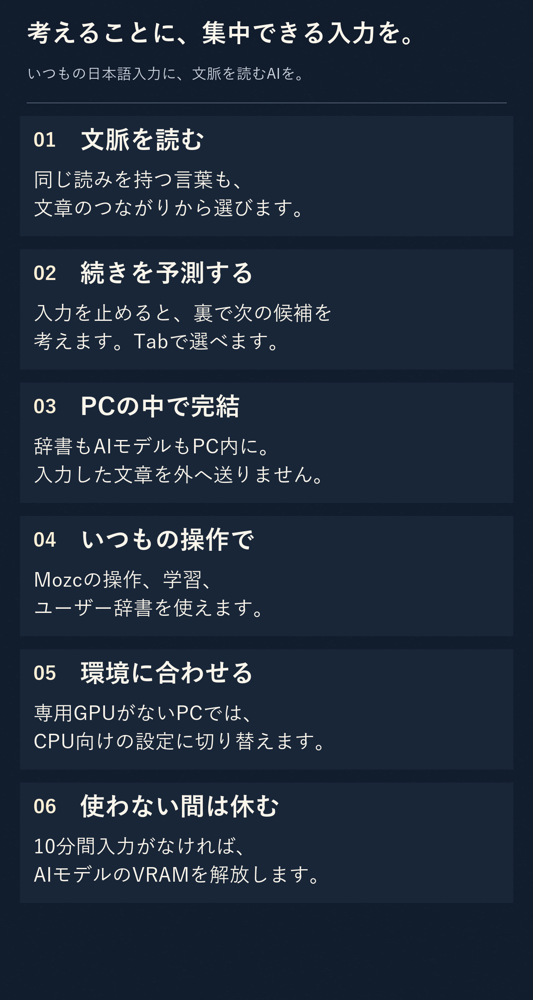
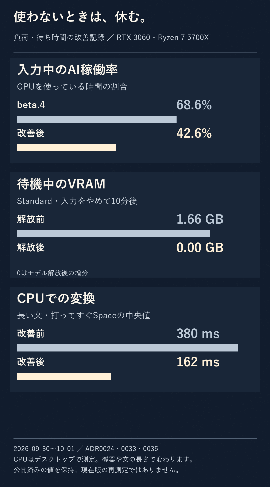
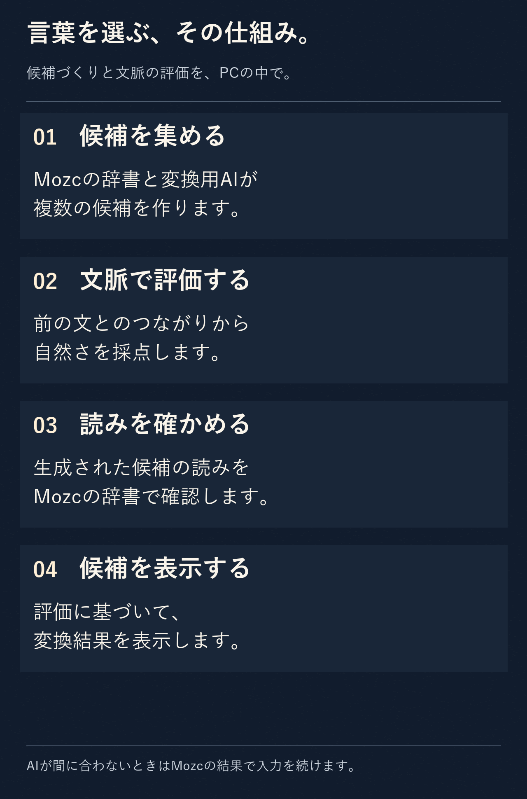

  

<h1 align="center">Asteria — アステリア（完全無料の日本語入力）</h1>

  <strong>文脈を手がかりに自然な候補を選ぶ、Windows向けの完全ローカルな日本語IMEです。</strong> 
  

  
  
  
  

<h2 align="center">
  <a href="https://github.com/aruiki/Asteria-Japanese-IME/releases/download/v1.1.4-rc.4/Asteria64.msi">⬇ Asteria日本語入力をダウンロード</a>
</h2>

  Windows 10 / 11・64bit

  <a href="https://github.com/aruiki/Asteria-Japanese-IME/releases/tag/v1.1.4-rc.4">新しいリリース候補 v1.1.4-rc.4</a>

## 実際の入力

  

## 開発版の変換精度（2026-10-19更新）

**v1.1.4-rc.2**は、AJIMEE-Bench 200問のオフライン評価で **188問正解（94.0%）** でした。Standard設定でAIの準備を終え、指定した前の文を渡した場合の値です。

  

| 評価条件 | 正解数 | 正解率 |
| --- | ---: | ---: |
| Standard・AI準備後・前文あり | 188 / 200 | **94.0%** |
| Standard・AI準備後・前文なし | 175 / 200 | 87.5% |
| AIなし・前文なし（Mozc＋追加連語） | 103 / 200 | 51.5% |

リリース候補の評価です。調整・回帰用データを固定変換器で測った結果であり、起動直後や実アプリでの精度を示す値ではありません。他IMEを含む最新の実入力比較は未実施です。

[測定条件・四つの評価セット](docs/BENCHMARKS.md) ／ [過去の実入力比較（2026-10-01）](docs/BENCHMARKS.md#過去の実入力比較) ／ [評価方法・データ](eval/README.md)

---

## 文脈から、自然な言葉を選ぶ

Asteriaは、Mozcの変換にAIによる文脈の評価を加えます。**文章のつながりを手がかりに、自然な候補を選びます**。

「公園」と「公演」、「制度」と「精度」。読みだけでは選びにくい言葉を、文章の意味から選び分けます。日常の同音語は、基礎となる辞書と連語も改善しています。

  

| 入力 | 変更前 | Asteria開発版 |
| --- | --- | --- |
| あめがふってきた | 雨が振ってきた | 雨が**降って**きた |
| じかんをはかる | 時間を図る | 時間を**計る** |
| たいじゅうをはかる | 体重を図る | 体重を**量る** |
| あついほん | 暑い本 | **厚い**本 |

上の例は追加連語の変更前後をAIなし・前文なしで比べた開発評価です。日常81問で65→69問正解、改善4問・改悪0問でした。[固定ソースと検証記録](docs/verification/accuracy-usage-collocations-20261018.md)を公開しています。

---

## 毎日の入力に、六つの工夫

  

**文脈を読む** 
同じ読みを持つ言葉も、文章のつながりから選びます。

**続きを予測する** 
入力を止めると、AIが裏で変換と文章の続きを考えます。予測候補はTabで選べます。

**PCの中で完結する** 
辞書もAIモデルもPC内にあります。入力した文章を外部サーバーへ送りません。

**いつもの操作で使う** 
Mozcの操作、学習、ユーザー辞書を利用できます。

**環境に合わせる** 
専用GPUがないPCでは、自動的にCPU向けの設定へ切り替わります。

**使わない間は休む** 
10分間入力がなければAIモデルをGPUから外し、VRAMを解放します。

---

## カタカナから、英語の表記へ

Asteriaには、カタカナ語から英語表記を選べる辞書も標準搭載しています。

| 入力 | 英語候補 |
| --- | --- |
| アーキテクチャ | `architecture` |
| アクセシビリティ | `accessibility` |
| コンフィギュレーション | `configuration` |
| レストラン | `restaurant` |

**31,068の読み・36,402組の英語表記**を収録しています。

日本語候補と一緒に、英語の表記も候補へ並びます。辞書や入力モードを切り替えずに選べます。

追加辞書のインポートも不要です。

---

## インストール

### 1. MSIをダウンロード

[**Asteria64.msi をダウンロード**](https://github.com/aruiki/Asteria-Japanese-IME/releases/download/v1.1.4-rc.4/Asteria64.msi)

### 2. インストーラーを実行

`Asteria64.msi` を開いてインストールします。

Windowsから「WindowsによってPCが保護されました」と表示された場合は、

**詳細情報 → 実行**

を選択してください。

### 3. Asteriaへ切り替える

インストール後、

**Windowsキー + Space**

から **Asteria日本語入力** を選択します。

日本語入力を始められます。

設定はデスクトップの **「Asteria」** から変更できます。

---

## 必要な環境

| | 必須 | おすすめ |
| --- | --- | --- |
| OS | Windows 10 1809以降 / 64bit | Windows 11 |
| メモリ | 8GB | 16GB |
| GPU | なくても動作 | Vulkan対応GPU / VRAM 3GB以上 |
| ディスク | 1.7GB | — |

NVIDIA / AMD / Intel Arc の専用GPUは自動検出します。

PythonやCUDAなど、AIを動かすための追加環境を自分でセットアップする必要はありません。

---

## 入力の流れを、大切に

開発中の次のリリース候補では、GPUで動くAIが最初の結果を出してから、変換・予測候補を表示します。Mozcの辞書・文節処理・履歴を基盤として、AIが候補を生成・採点します。

AIの準備・処理を待つ間も、入力した文字の表示・編集・取消を続けられます。Enterでの確定や、その後に続けて打った文字も順番に処理します。AIを明示的に切った場合や、実行できない場合も入力を継続できます。[次版の検証状況](docs/verification/ai-first-publication-20261019.md)を公開しています。

  

上の図は、先行版のネイティブ入力処理をCPU・GPUで各30シナリオ確認した結果です。起動直後15件とAI準備後15件で、文字欠落や確定差分などの検出不具合は0件でした。次版ではキーへの応答とAI結果の到着を分けて検査しています。[測定条件](docs/BENCHMARKS.md#入力応答)と[次版の検証状況](docs/verification/ai-first-publication-20261019.md)を公開しています。

10分間日本語を入力しなければAIモデルをGPUから外し、使用していたVRAMも解放します。

---

## 言葉を選ぶ仕組み

Asteriaの基盤はMozcです。**辞書・変換・学習の仕組みに、AIによる候補の生成と文脈の評価を加えています**。

  

1. **候補を作る**  
   Mozcと変換用AIから複数の候補を集めます。

2. **文脈から評価する**  
   AIが文章全体を見て、それぞれの候補がどれだけ自然か評価します。

3. **読みを確認する**  
   AIが生成した候補はMozcの辞書でも確認し、読みと一致しないものを除外します。

4. **候補を表示する** 
   評価に基づいて、IMEの変換結果を表示します。

AIが読みにない単語を勝手に追加したり、ユーザー辞書へ登録した言葉を書き換えたりすることはありません。

詳しい設計は [docs/adr/](docs/adr/) にあります。

---

## 文章は、このPCの中に

AsteriaのAIモデル、辞書、変換処理はすべてPC内で動作します。

**入力した文字を外部のAIサービスやサーバーへ送信しません。**

インターネット接続がなくても、AI変換を利用できます。

---

## 困ったとき

使い方、アンインストール、データの保存場所、トラブル対処は

[**使い方と困ったとき**](docs/USER_GUIDE.md)

にまとめています。

不具合・誤変換・要望は [Issues](https://github.com/aruiki/Asteria-Japanese-IME/issues/new/choose) へお願いします。

---

## 開発者向け

- [開発方法](docs/DEVELOPMENT.md)
- [評価方法](eval/README.md)
- [性能測定](docs/PERFORMANCE.md)
- [設計記録](docs/adr/)
- [仕様](docs/SPEC.md)
- [開発規約](AGENTS.md)

---

## 開発を支援する

Asteriaは無料のオープンソースソフトウェアとして開発しています。

[**Stripeから開発を支援する**](https://buy.stripe.com/cNi14m7jRdq005f0781ZS08)

支援の有無による機能制限はありません。

---

## ライセンス

Asteriaのコードは **Apache License 2.0 / MIT License** のデュアルライセンスです。

Mozcへの変更はBSD-3-Clauseです。

同梱コンポーネントを含む詳細は [docs/licenses.md](docs/licenses.md) を参照してください。

---

<h2 align="center">
  <a href="https://github.com/aruiki/Asteria-Japanese-IME/releases/download/v1.1.4-rc.4/Asteria64.msi">⬇ Asteria日本語入力を試す</a>
</h2>

  Windows 10 / 11・無料・完全オフライン・GPUなしでも利用可能

