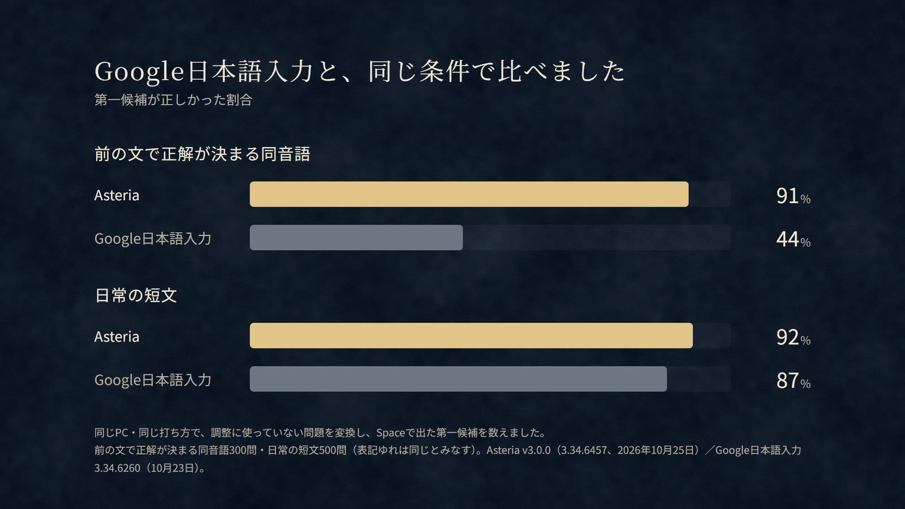

  <picture>
    <source media="(prefers-color-scheme: dark)" srcset="docs/images/crescent.png">
    
  </picture>

<h1 align="center">打ちたい言葉が、Space 1回で。</h1>

  <strong>Asteria（アステリア）は、変換精度の高い Windows の日本語入力です。</strong> 
  長い文も、前の文の流れも読んで、最初の候補で正しく変換します。 
  無料・オープンソース。入力した文章は外へ送りません。

<h3 align="center">
  <a href="https://github.com/aruiki/Asteria-Japanese-IME/releases/download/v3.0.0/Asteria64.msi">↓ 無料でダウンロード（Windows 10 / 11）</a>
</h3>

  v3.0.0 正式版 · 約1.7 GB · アカウント登録なし · 1画面でインストール 
  アンインストールしても学習した内容は残り、入れ直せば元どおりに使えます。

 

  
   
  実際の入力をそのまま録画しています（候補の選び直しなし）。<a href="docs/marketing/assets/asteria-v3-promo.mp4">▶ 音つきの紹介動画（39秒）</a>

## 変換し直す手間が、ほとんどなくなります

誤変換を見つけて、戻って、候補を選び直す。その数秒が一日に何十回も重なります。Asteria は、辞書による変換（Mozc）に、あなたの PC の GPU で動く AI を組み合わせ、**最初の候補を正しくする**ことに集中しています。

| | こんなとき | Asteria では |
| --- | --- | --- |
| **長い文** | 句読点までまとめて打ってから変換したい | 107文字を続けて打っても、Space 1回で文全体を正しく区切って変換 |
| **同じ読みの言葉** | 「かんしょうする」が鑑賞なのか干渉なのか | 前の文を読み、「絵を**鑑賞する**」「親が**干渉する**」と書き分け |
| **英語の言葉** | GitHub や Zoom がカタカナになる | 英語のつづりのまま「**GitHub**にレポジトリを…」と変換 |

## Google日本語入力と、同じ条件で比べました

  

同じPC・同じ打ち方で、調整に使っていない問題を変換し、Space で出た最初の候補を数えました。前の文で意味が決まる同音語では 274問 対 133問、日常の短文では 461問 対 434問。Asteria v3.0.0（2026年10月25日）と Google日本語入力 3.34.6260（10月23日）の結果です。[測り方と全結果](docs/verification/release-v3.0.0-20261024.md#google日本語入力との比較の測り直し紹介動画のグラフ2026-10-25)

## インストールは1画面

1. **[Asteria64.msi をダウンロード](https://github.com/aruiki/Asteria-Japanese-IME/releases/download/v3.0.0/Asteria64.msi)** して開きます。
2. **「インストール」** を押し、Windows の確認を許可します。完了の画面が出たら終わりです。
3. **Windows + Space** で「Asteria日本語入力」を選びます。

インストールの途中で「開いているアプリを閉じてください」と求めることはありません。v3.0.0 以降の更新は再起動もいりません（v2.0.0 以前からの更新だけ、最後に再起動をお願いします）。

## 安心して使えるように

- **文章はPCの中だけ** — 辞書も AI もインストーラーに入っていて、変換のために通信しません。パスワード欄では、文脈の読み取り・AI・学習を止めるように作っています。
- **AIが止まっても入力は止まらない** — GPU が使えない・AI の準備中でも、辞書による変換で入力を続けます。
- **中身を確かめられる** — ソースコードと、精度の測り方・失敗例まで公開しています（Apache-2.0 / MIT、Mozc の変更は BSD-3-Clause）。
- **使い方が見える** — 設定画面に、今日の変換回数・Space から候補までの時間・1番目の候補で確定した割合を表示します。数えるのは回数と時間だけです。

<strong>よくある質問</strong>

**GPU がない PC でも使えますか？** 
使えます。CPU 向けの設定（Low）で動きます。精度と速さは GPU（Vulkan 対応の専用 GPU、VRAM 3 GiB 以上）の Standard と同じではありません。

**「WindowsによってPCが保護されました」と出ました。** 
配布ファイルは未署名のため、SmartScreen が表示されることがあります。公式の Release から入手したことと SHA-256 を確かめてから「詳細情報 → 実行」を選んでください。[導入ガイド](docs/INSTALL.md#smartscreenが表示されたとき)

**容量が大きいのはなぜですか？** 
変換に使う AI のモデルと実行環境を同梱しているためです（ディスクに約1.7 GB）。Python や CUDA を別に入れる必要はありません。

**Google日本語入力や Microsoft IME と一緒に入れられますか？** 
入れられます。Windows + Space でいつでも切り替えられます。

**どんなときに間違えますか？** 
文の意味で決まる同音語（駐車／注射など）や、人名・店名などの固有名詞は、ほかより誤りが多くなります。打ち終えてすぐ Space を押すと、候補まで 0.3 秒ほどかかることがあります。[既知の問題](https://github.com/aruiki/Asteria-Japanese-IME/releases/tag/v3.0.0)

<strong>動作環境</strong>

| 項目 | 条件 |
| --- | --- |
| OS | Windows 10 1809 以降 / Windows 11（64bit） |
| メモリ | 8 GB 以上（16 GB 推奨） |
| GPU（AI） | Vulkan 対応の専用 GPU、VRAM 3 GiB 以上（NVIDIA / AMD / Intel Arc）。内蔵 GPU は使いません |
| GPU のない PC | CPU 向けの Low 設定で動作 |
| ディスク | 約1.7 GB |

10分間入力がなければ、GPU の AI モデルを外して VRAM を空けます。

<strong>検証の範囲と、まだできていないこと</strong>

v3.0.0 の配布 MSI は、GitHub の CI（素の Windows）で導入・日本語入力・削除を確認し、同じソースの版をこの PC（Windows 11、RTX 3060）で前の版からの更新・実入力・削除まで確認しています。Office などのアプリ、低性能の実機、GPU のない PC、保護欄の内部は未検証です。精度の目標（短文・文書 95%、専門語・固有名詞 90%）にはまだ届いていません。[v3.0.0 の検証記録](docs/verification/release-v3.0.0-20261024.md) ／ [評価方法とデータ](eval/README.md)

<h3 align="center">
  <a href="https://github.com/aruiki/Asteria-Japanese-IME/releases/download/v3.0.0/Asteria64.msi">↓ Asteria を無料で試す</a>
</h3>

Windows 10 / 11 · 無料・オープンソース · 文章はPCの中に

---

**気に入ったら** — GitHub の ⭐ Star が、開発を続ける一番の励みになります。[Stripe から開発を支援](https://buy.stripe.com/cNi14m7jRdq005f0781ZS08)もできます（支援の有無で機能は変わりません）。

[使い方と困ったとき](docs/USER_GUIDE.md) ・ [不具合・誤変換を報告](https://github.com/aruiki/Asteria-Japanese-IME/issues/new/choose) ・ [公式サイト](https://aruiki.github.io/kanai/) ・ [紹介用の画像と文章](docs/marketing/README.md) ・ [開発方法](docs/DEVELOPMENT.md) ・ [設計記録](docs/adr/) ・ [ライセンス](docs/licenses.md) ・ [セキュリティ](SECURITY.md)

紹介動画の音楽: 「流るる時」（YouTube オーディオライブラリ）。打鍵音: NCPRIME（Pixabay）。変換の音は Asteria で作成。
