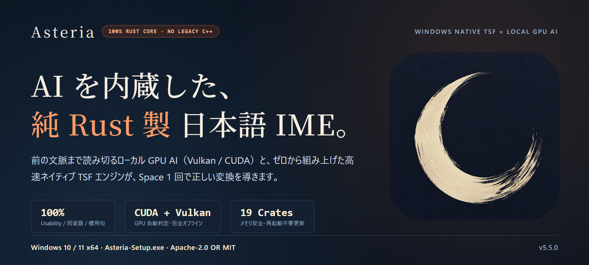
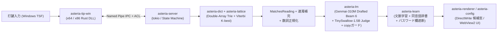

<p align="center">
  <picture>
    <source media="(prefers-color-scheme: dark)" srcset="docs/images/crescent.png">
    
  </picture>
</p>

<h1 align="center">Asteria 日本語入力</h1>

<p align="center">
  <strong>Built from Scratch in Rust × Local GPU AI</strong><br>
  前の文まで読むオフライン AI と、純 Rust ネイティブ TSF エンジンが、<br>
  打ちたい言葉を <strong>Space 1 回</strong> で導き出す次世代 Windows 日本語入力。
</p>

<p align="center">
  <a href="https://github.com/aruiki/Asteria-Japanese-IME/releases/latest"></a>
  
  
  
  
  
</p>

<p align="center">
  
</p>

<h3 align="center">
  <a href="https://github.com/aruiki/Asteria-Japanese-IME/releases/latest/download/Asteria-Setup.exe">↓ Asteria-Setup.exe をダウンロード（無料・Windows 10 / 11）</a>
</h3>

<p align="center"><sub>v5.5.0 · 単一インストーラ（Vulkan 標準 + NVIDIA CUDA 自動導入）· アカウント登録なし · 100% ローカル処理</sub></p>

---

## 既存 IME の改造ではない。ゼロから書いた Rust エンジン。

世の中のオープンソース日本語 IME の多くは、巨大なレガシー C++ コードベースにパッチを重ねた派生品です。  
**Asteria v5.5.0 は異なります。** Windows の TSF（Text Services Framework）DLL から、ダブル配列トライ辞書、Viterbi ラティス探索、読み整合バリデータ、文脈学習、IPC サーバー、WebView2 設定 UI、無停止アップグレーダに至るまで、**19 クレートのコア基盤を Rust で新規設計**しました。

| 設計軸 | 従来の派生 IME（C++ 改造型） | **Asteria（Pure Rust + Local AI）** |
| :--- | :--- | :--- |
| **変換コア実装** | レガシー C++ デーモンへのパッチ追加 | **19 クレートの純 Rust ワークスペース**（基盤クレート `#![deny(unsafe_code)]`） |
| **読み・表記の安全性** | AI 生成時の読み崩れ・文字化け混入リスク | **`MatchesReading` 読み完全照合**＋複合語連濁フォールバック＋文字種チェック |
| **文脈・同音語判断** | 文節単体の静的コスト中心 | **`Genmai-310M` Drafted Beam + `TinySwallow-1.5B` 2 段階 AI**＋直前 256 文字文脈 |
| **左文脈の引きずり対策** | 前文に出た同音語を無意識に反復しやすい | **孤立再採点 `[copy]`** ＋既定同音語辞書コピー抑止ガード |
| **GPU 推論バックエンド** | CPU 中心または Vulkan 単一経路 | **Vulkan 標準 + NVIDIA GPU 時は CUDA (`Flash Attention`) を自動読込** |
| **導入・アップデート** | 複数 MSI やアプリ終了・再起動要求 | **`Asteria-Setup.exe` 1 本完結**・版付き TIP DLL による**再起動不要更新** |

<details>
<summary>システムアーキテクチャを見る（19 Pure-Rust Crates）</summary>



- **辞書データと推論カーネルの分離**: 変換・探索・学習エンジンは 100% 純 Rust 実装です。システム辞書の語彙素材としてオープンソース辞書コーパスを独自コンパイラ `asteria-dictc` で mmap バイナリ辞書へコンパイルし、GGUF 推論カーネルのみ `llama.cpp`（Vulkan / CUDA）を利用しています。

</details>

---

## 変換精度と速度の実測値

`v5.5.0`（Standard: `Genmai-310M-q8_0` + `TinySwallow-1.5B-q5_k_m`、NVIDIA GeForce RTX 3060）で、8 種類の評価セットすべてを実測した成績です。

| 評価ベンチマーク | 問題数 | Acc@1 (正答率) | Acc@10 (候補内) | CER | 内容 |
| :--- | ---: | ---: | ---: | ---: | :--- |
| **実用マルチ正解 (`usability-multi`)** | 120 | **100.0%** | 100.0% | 0.00% | 日常〜長文・表記ゆれ許容の実入力評価 |
| **同音異義語 (`homophone`)** | 40 | **100.0%** | 100.0% | 0.00% | 文脈依存の同音語選択 |
| **慣用句・表現 (`idioms`)** | 25 | **100.0%** | 100.0% | 0.00% | 誤変換しやすい慣用句・定型表現 |
| **報告回帰 (`user-reports`)** | 6 | **100.0%** | 100.0% | 0.00% | 実ユーザーから報告された誤変換ケース |
| **ゴールデン (`golden`)** | 3 | **100.0%** | 100.0% | 0.00% | 必須維持テストケース |
| **日常文 (`daily`)** | 81 | **100.0% (CUDA)** / 98.8% (Vulkan) | 100.0% | 0.00% / 0.27% | 標準的な日常短文 |
| **未調整ホールドアウト (`heldout`)** | 300 | **99.0%** | 100.0% | 0.14% | 調整に使っていない独立テスト |
| **難文・複合語 (`ajimee`)** | 200 | **95.5%** | 98.5% | 0.40% | 連濁・難読語を含む長文ベンチ |

### 応答速度の比較 (`converter-runner` E2E / RTX 3060)

- **従来 Google 日本語入力 / Mozc (`v3.34`) 比**:
  - `daily`（81 問）合計処理時間: **`10.63s`**（従来 `15.66s` 比 **32% 短縮**、最大遅延 `167.5ms` vs `847ms`）
  - `ajimee`（200 問）合計処理時間: **`43.83s`**（従来 `53.35s` 比 **18% 短縮**、最大遅延 `551.2ms` vs `918ms`）

---

## 実入力イメージ

<p align="center">
  <a href="https://aruiki.github.io/kanai/asteria-v3-promo.mp4?v=3.0.0">
    
  </a>
</p>

## 日常の使いやすさとプライバシー

- **Space を押したときだけ変換**: 入力中に勝手に文字が確定・変化しないため、いつもの操作感（Space 変換 / Enter 確定 / Shift+←→ 文節伸縮 / Tab で AI 次文予測）のまま使えます。好みで「ライブ変換」や「同音語ヒント」もオンにできます。
- **完全オフライン・Zero Telemetry**: 辞書も AI モデルもすべてローカルで完結。入力した文章・変換ログ・利用統計が外部へ送信されることは一切ありません。
- **パスワード欄・シークレットモード保護**: パスワード入力欄では自動で直接入力へ切り替わり、プライベートウィンドウ等では学習・予測を行いません。
- **打ち間違い補正 & カタカナ英語辞典**: タイポ補正や `github → GitHub` などのローマ字英語変換、31,000 語超のカタカナ英語表記補完にも対応。

---

## インストール（1 クリック完結）

1. **[Asteria-Setup.exe](https://github.com/aruiki/Asteria-Japanese-IME/releases/latest/download/Asteria-Setup.exe)** をダウンロードして実行します。
   - 本体（`Asteria64.msi`）に加え、NVIDIA GPU を検出すると高速化用 CUDA アドオン（`AsteriaCuda64.msi`）も自動で導入されます。
   - 単体 MSI（`Asteria64.msi` / `AsteriaCuda64.msi`）が必要な場合は [Releases ページ](https://github.com/aruiki/Asteria-Japanese-IME/releases/latest) から個別に取得できます。
2. 完了後、**Windows + Space** で「**Asteria 日本語入力**」を選択します。
   - 版付き TSF DLL 機構により、今後のアップデートも **アプリ終了・PC 再起動なし** で上書き更新できます。

> [!NOTE]
> インストーラは未署名のため、初回実行時に SmartScreen（**「Windows によって PC が保護されました」**）が表示されることがあります。**「詳細情報」→「実行」** で進められます。同梱の `.sha256` と `Get-FileHash -Algorithm SHA256` で配布ファイルの完全性を検証できます。詳しくは [導入ガイド](docs/INSTALL.md) をご覧ください。

<details>
<summary>動作環境・開発者向けビルド方法</summary>

### 動作環境
| 項目 | 条件 |
| :--- | :--- |
| **OS** | Windows 10 (1809 以降) / Windows 11（64-bit） |
| **メモリ** | 8 GB 以上（16 GB 推奨） |
| **ディスク空き容量** | 約 2.0 GB（ローカル AI モデル・辞書含む） |
| **GPU（推奨）** | Vulkan 対応 GPU（VRAM 3 GiB 以上）または NVIDIA GPU（CUDA 自動有効）。GPU 非搭載環境では自動で CPU 軽量モードで動作 |

### ソースからの開発・テスト
```powershell
# リント・全テスト（19 クレート Rust ワークスペース）
just ci

# Windows インストーラ（MSI + CUDA Addon + Burn 単一 Setup EXE）の一括ビルド
.\frontends\windows\build.ps1 -OutDir target\msi-dist -BuildMsi -BuildBundle -MsiVersion 5.5.0
```

</details>

---

<p align="center"><sub>
  <a href="docs/USER_GUIDE.md">使い方と設定ガイド</a>　·　
  <a href="docs/INSTALL.md">導入・SmartScreen・SHA-256 検証</a>　·　
  <a href="https://aruiki.github.io/kanai/">紹介ページ</a>　·　
  <a href="https://github.com/aruiki/Asteria-Japanese-IME/issues/new/choose">不具合・誤変換の報告</a>　·　
  <a href="docs/licenses.md">ライセンス</a>
</sub></p>
