<p align="center">
  <picture>
    <source media="(prefers-color-scheme: dark)" srcset="docs/images/crescent.png">
    
  </picture>
</p>

<h1 align="center">Asteria Japanese Input</h1>

<p align="center">
  <strong>Built from scratch in Rust × Local GPU AI</strong><br>
  A native Windows IME written in Rust — not a legacy C++ fork.<br>
  Reads the preceding text and runs its AI completely offline on your PC.
</p>

<p align="center">
  <a href="https://github.com/aruiki/Asteria-Japanese-IME/releases/latest"></a>
  
  
  
  
  
</p>

<h3 align="center">
  <a href="https://github.com/aruiki/Asteria-Japanese-IME/releases/latest/download/Asteria-Setup.exe">Download Asteria-Setup.exe</a>
</h3>

<p align="center"><sub>v5.5.2 · Web Setup (about 1.5 MB) · Windows 10 / 11 64-bit · Free &amp; Open Source</sub></p>

---

## Why Built from Scratch in Rust

Most open-source Japanese IMEs are patched forks of legacy C++ engines. **Asteria is a clean-slate 19-crate Rust architecture** engineered for memory safety, predictable latency, and deep contextual accuracy:

- **19 Pure-Rust Crates (`#![deny(unsafe_code)]` foundation):** Windows TSF service DLL (`asteria-tip-win`, x64/x86), double-array trie dictionary (`asteria-dict`), Viterbi K-best lattice search (`asteria-lattice`), context learner (`asteria-learn`), IPC server (`asteria-server`), DirectWrite candidate renderer (`asteria-renderer`), WebView2 settings app (`asteria-config`), and restart-free MSI custom actions (`asteria-msi-action`).
- **Context-Aware Two-Stage GPU AI (`Genmai-310M` + `TinySwallow-1.5B`):** Reads up to 256 characters of preceding text, runs drafted beam search (`beams=6`), prevents left-context homophone copying (`[copy]` isolated rescoring), and runs on Vulkan by default with automatic CUDA acceleration (`Flash Attention`) on supported NVIDIA GPUs.
- **Zero Garbled AI Candidates (`MatchesReading` + Rendaku):** Every AI candidate is verified against the typed reading at the dictionary level—including compound sequential voicing (rendaku) and mixed numeral normalization—so fabricated kanji readings never reach the candidate window.

## The right kanji on the first press

| You type | Preceding context | One press of Space gives | Meaning |
| :--- | :--- | :--- | :--- |
| `しょうひんのひんしつをほしょうします` | — | 商品の品質を**保証**します | *Guarantee* product quality |
| `こくみんのせいかつをほしょうする` | — | 国民の生活を**保障**する | *Secure* people's livelihoods |
| `じこのそんがいをほしょうする` | — | 事故の損害を**補償**する | *Compensate* for accident damage |
| `にほんごをかいせつ` | 口座を開設しました。 | 日本語を**解説** | *Explain* Japanese (not tricked by prior 開設) |

<p align="center">
  <a href="https://aruiki.github.io/kanai/asteria-v3-promo.mp4?v=3.0.0">
    
  </a>
</p>

## Features

- **Works the way you already type.** Text never changes unexpectedly while typing; Space converts, Enter confirms, Shift+←/→ adjusts segments, and Tab selects AI next-sentence predictions (optional live conversion is also available).
- **100% Offline & Zero Telemetry.** Dictionary lookup, learning, and GPU AI inference all happen locally. Nothing you type leaves your PC. Password fields automatically switch to direct input and private windows are never learned.
- **Fast with GPU, reliable without one.** Runs on any Vulkan GPU (3 GiB+ VRAM) and auto-enables CUDA on NVIDIA cards; falls back cleanly to a light CPU mode when no dedicated GPU is present.
- **Restart-free updates.** Versioned TSF DLLs (`asteria_tip64-<ver>.dll` / `asteria_tip32-<ver>.dll`) let you upgrade without closing running apps or restarting Windows.

## Accuracy and speed

Measured with `v5.5.2` on `Standard` (`Genmai-310M-q8_0` + `TinySwallow-1.5B-q5_k_m`, NVIDIA GeForce RTX 3060):

| Test set | Questions | Acc@1 (Top candidate) | Acc@10 | CER |
| :--- | ---: | ---: | ---: | ---: |
| Practical writing, variants accepted (`usability-multi`) | 120 | **100.0%** | 100.0% | 0.00% |
| Homophones (`homophone`) | 40 | **100.0%** | 100.0% | 0.00% |
| Idioms and set phrases (`idioms`) | 25 | **100.0%** | 100.0% | 0.00% |
| User-reported regressions (`reports`) | 6 | **100.0%** | 100.0% | 0.00% |
| Regression golden (`golden`) | 3 | **100.0%** | 100.0% | 0.00% |
| Short everyday sentences (`daily`) | 81 | **100.0% (CUDA)** · 98.8% (Vulkan) | 100.0% | 0.00% / 0.27% |
| Held-out set, never used for tuning (`heldout`) | 300 | **99.0%** | 100.0% | 0.14% |
| Long sentences with compounds &amp; rare readings (`ajimee`) | 200 | **95.5%** | 98.5% | 0.40% |

End-to-end conversion speed compared against Google Japanese Input / Mozc (`v3.34`) under the same procedure: total time dropped from `15.66 s` to **`10.63 s`** on `daily` (`-32%`, max latency `167.5 ms` vs `847 ms`) and from `53.35 s` to **`43.83 s`** on `ajimee` (`-18%`).

## Install

1. Download and run **[Asteria-Setup.exe](https://github.com/aruiki/Asteria-Japanese-IME/releases/latest/download/Asteria-Setup.exe)** (about 1.5 MB).
   - During setup it downloads Asteria itself (about 1.5 GB), plus the CUDA add-on (about 0.5 GB) if you have a supported NVIDIA GPU. An internet connection is needed only during installation.
   - For offline PCs, place `Asteria64.msi` (and `AsteriaCuda64.msi` if needed) from [asteria-downloads](https://github.com/aruiki/asteria-downloads/releases) next to `Asteria-Setup.exe`.
2. Press **Windows + Space** and choose **Asteria**.

> [!NOTE]
> The installer is not code-signed, so Windows SmartScreen may show "Windows protected your PC" on first run. Click **More info**, then **Run anyway**. You can verify the installer with `checksums.txt`; see [INSTALL.md](docs/INSTALL.md) (Japanese).

<details>
<summary>System requirements &amp; Architecture (for developers)</summary>

### System requirements
| Item | Requirement |
| :--- | :--- |
| **OS** | Windows 10 (1809 or later) / Windows 11, 64-bit |
| **Memory** | 8 GB or more (16 GB recommended) |
| **Disk space** | About 2.0 GB (including local AI models and dictionary) |
| **GPU (recommended)** | Vulkan GPU (3 GiB+ VRAM) or NVIDIA GPU (CUDA auto-enabled); runs in light CPU mode otherwise |

### Pure-Rust 19-Crate Pipeline

```mermaid
flowchart LR
    Key["Keystrokes (Windows TSF)"] --> TIP["asteria-tip-win<br/>(x64 / x86 Rust DLL)"]
    TIP <-->|Named Pipe IPC + ACL| Server["asteria-server<br/>(tokio / state machine)"]
    Server --> Lattice["asteria-dict + asteria-lattice<br/>(double-array trie + Viterbi K-best)"]
    Lattice --> Validate["MatchesReading + rendaku fallback<br/>+ numeral normalization"]
    Validate --> LM["asteria-lm<br/>(Genmai-310M drafted beam 6<br/>+ TinySwallow-1.5B judge + copy guard)"]
    LM --> Learn["asteria-learn<br/>(context learning + homophone dictionary<br/>+ password-field guard)"]
    Learn --> UI["asteria-renderer / asteria-config<br/>(DirectWrite candidate window / WebView2 UI)"]
```



The conversion engine itself uses zero legacy C++ IME code (`llama.cpp` is used only for GGUF inference, and open-source dictionary data is compiled to mmap binary form by `asteria-dictc`).

```powershell
# Lint and run all tests across the Rust workspace
just ci

# Build Windows MSIs + Web Setup EXE
.\frontends\windows\build.ps1 -OutDir target\msi-dist -BuildMsi -BuildBundle -MsiVersion 5.5.2
```

</details>

---

<p align="center"><sub>
  <a href="docs/USER_GUIDE.md">User guide</a>　·　
  <a href="docs/INSTALL.md">Installation, SmartScreen &amp; checksums</a>　·　
  <a href="https://aruiki.github.io/kanai/">Project page</a>　·　
  <a href="https://github.com/aruiki/Asteria-Japanese-IME/issues/new/choose">Report a bug or a wrong conversion</a>　·　
  <a href="docs/licenses.md">Licenses</a>
</sub></p>
