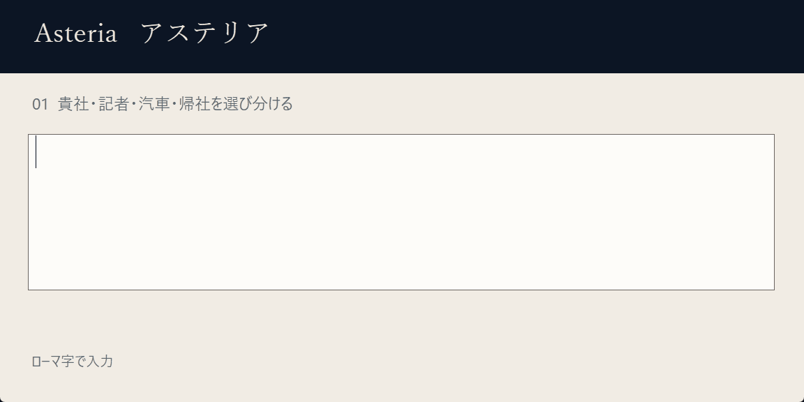
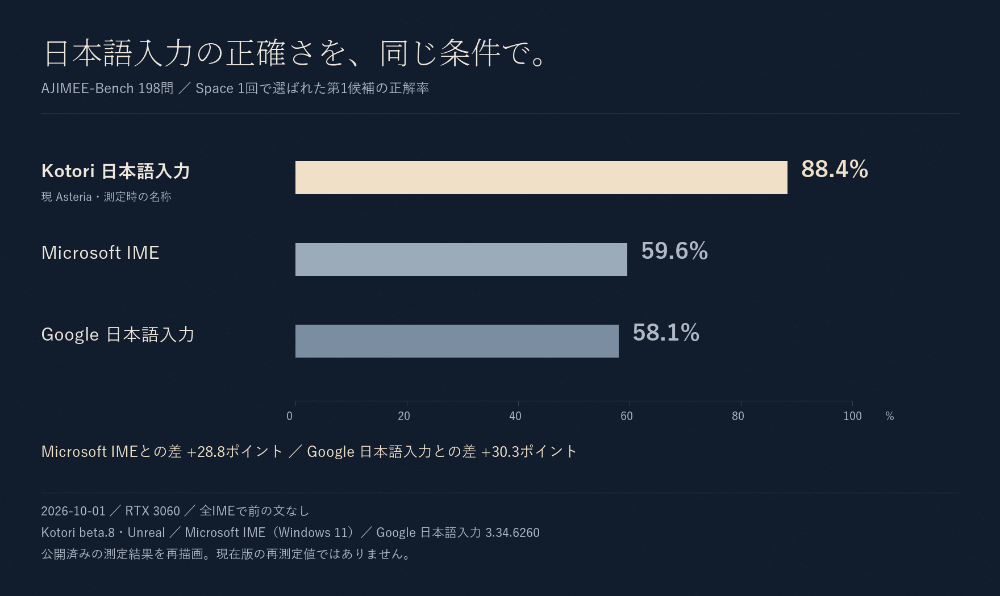

  

<h1 align="center">Asteria — アステリア（完全無料の日本語入力）</h1>

  <strong>文脈を理解し常に最適な変換をするWindows向けの完全ローカルな日本語IMEです。</strong> 
  

  
  
  
  

<h2 align="center">
  <a href="https://github.com/aruiki/Asteria-Japanese-IME/releases/latest/download/Asteria64.msi">⬇ Asteria日本語入力をダウンロード</a>
</h2>

  Windows 10 / 11・64bit

## 実際の入力

  

  

AJIMEE-Bench 198問を、**実際に各IMEへ入力して比較**しました。Kotori日本語入力（現Asteria）の正解率は **88.4%** でした。

| IME | 正解率 |
| --- | ---: |
| **Kotori日本語入力** | **88.4%** |
| Microsoft IME | 59.6% |
| Google 日本語入力 | 58.1% |

すべて同じ入力方法・同じ条件で、Spaceを1回押したときの第1候補を比較しています。

> この比較は2026-10-01時点の Kotori beta.8 / Unreal で測定したものです。  
> 現在版の再測定値ではありません。

評価方法・テストデータ・CSVは [eval/README.md](eval/README.md) で公開しています。

---

---

## 文脈から、自然な言葉を選ぶ

Asteriaは、Mozcの変換にAIによる文脈の評価を加えます。**文章のつながりを手がかりに、自然な候補を選びます**。

「公園」と「公演」、「制度」と「精度」。読みだけでは選びにくい言葉を、文章の意味から選び分けます。

  

| 入力 | Mozc | Kotori |
| --- | --- | --- |
| かれはこうえんでこうえんをした | 彼は公園で公園をした | 彼は公園で**公演**をした |
| おんせいにんしきのせいどがあがった | 音声認識の制度が上がった | 音声認識の**精度**が上がった |
| あしたのかいぎはじゅうじからです | 明日の会議は従事からです | 明日の会議は**10時**からです |
| このやくはむずかしい | この薬は難しい | 文脈に応じて **この訳は難しい** |

直前に確定した文章も、候補を選ぶ手がかりにできます。上の例は2026-10-01のStandard設定で確認した出力です。

---

## 毎日の入力に、六つの工夫

  

**文脈を読む** 
同じ読みを持つ言葉も、文章のつながりから選びます。

**続きを予測する** 
入力を止めると、AIが裏で変換と文章の続きを考えます。予測候補はTabで選べます。

**PCの中で完結する** 
辞書もAIモデルもPC内にあります。入力した文章を外部サーバーへ送りません。

**いつもの操作で使う** 
Mozcの操作、学習、ユーザー辞書を利用できます。

**環境に合わせる** 
専用GPUがないPCでは、自動的にCPU向けの設定へ切り替わります。

**使わない間は休む** 
10分間入力がなければAIモデルをGPUから外し、VRAMを解放します。

---

## カタカナから、英語の表記へ

Asteriaには、カタカナ語から英語表記を選べる辞書も標準搭載しています。

| 入力 | 英語候補 |
| --- | --- |
| アーキテクチャ | `architecture` |
| アクセシビリティ | `accessibility` |
| コンフィギュレーション | `configuration` |
| レストラン | `restaurant` |

**31,068の読み・36,402組の英語表記**を収録しています。

日本語候補と一緒に、英語の表記も候補へ並びます。辞書や入力モードを切り替えずに選べます。

追加辞書のインポートも不要です。

---

## インストール

### 1. MSIをダウンロード

[**Asteria64.msi をダウンロード**](https://github.com/aruiki/Asteria-Japanese-IME/releases/latest/download/Asteria64.msi)

### 2. インストーラーを実行

`Asteria64.msi` を開いてインストールします。

Windowsから「WindowsによってPCが保護されました」と表示された場合は、

**詳細情報 → 実行**

を選択してください。

### 3. Asteriaへ切り替える

インストール後、

**Windowsキー + Space**

から **Asteria日本語入力** を選択します。

日本語入力を始められます。

設定はデスクトップの **「Asteria」** から変更できます。

---

## 必要な環境

| | 必須 | おすすめ |
| --- | --- | --- |
| OS | Windows 10 1809以降 / 64bit | Windows 11 |
| メモリ | 8GB | 16GB |
| GPU | なくても動作 | Vulkan対応GPU / VRAM 3GB以上 |
| ディスク | 1.7GB | — |

NVIDIA / AMD / Intel Arc の専用GPUは自動検出します。

PythonやCUDAなど、AIを動かすための追加環境を自分でセットアップする必要はありません。

---

## 入力の流れを、大切に

通常のキー入力はMozcが処理するため、AIの計算完了を待ちません。

AIによる変換も処理時間に上限を設けており、間に合わない場合はMozcの結果をそのまま表示します。

  

2026-10-01のRTX 3060環境・Standard設定では、AI変換1回の中央値は約 **0.06秒** でした。機器や文章によって時間は変わります。測定条件は [性能測定](docs/PERFORMANCE.md) に記録しています。

10分間日本語を入力しなければAIモデルをGPUから外し、使用していたVRAMも解放します。

---

## 言葉を選ぶ仕組み

Asteriaの基盤はMozcです。**辞書・変換・学習の仕組みに、AIによる候補の生成と文脈の評価を加えています**。

  

1. **候補を作る**  
   Mozcと変換用AIから複数の候補を集めます。

2. **文脈から評価する**  
   AIが文章全体を見て、それぞれの候補がどれだけ自然か評価します。

3. **読みを確認する**  
   AIが生成した候補はMozcの辞書でも確認し、読みと一致しないものを除外します。

4. **候補を表示する** 
   評価に基づいて、IMEの変換結果を表示します。

AIが読みにない単語を勝手に追加したり、ユーザー辞書へ登録した言葉を書き換えたりすることはありません。

詳しい設計は [docs/adr/](docs/adr/) にあります。

---

## 文章は、このPCの中に

AsteriaのAIモデル、辞書、変換処理はすべてPC内で動作します。

**入力した文字を外部のAIサービスやサーバーへ送信しません。**

インターネット接続がなくても、AI変換を利用できます。

---

## 困ったとき

使い方、アンインストール、データの保存場所、トラブル対処は

[**使い方と困ったとき**](docs/USER_GUIDE.md)

にまとめています。

不具合・誤変換・要望は [Issues](https://github.com/aruiki/Asteria-Japanese-IME/issues/new/choose) へお願いします。

---

## 開発者向け

- [開発方法](docs/DEVELOPMENT.md)
- [評価方法](eval/README.md)
- [性能測定](docs/PERFORMANCE.md)
- [設計記録](docs/adr/)
- [仕様](docs/SPEC.md)
- [開発規約](AGENTS.md)

---

## 開発を支援する

Asteriaは無料のオープンソースソフトウェアとして開発しています。

[**Stripeから開発を支援する**](https://buy.stripe.com/cNi14m7jRdq005f0781ZS08)

支援の有無による機能制限はありません。

---

## ライセンス

Asteriaのコードは **Apache License 2.0 / MIT License** のデュアルライセンスです。

Mozcへの変更はBSD-3-Clauseです。

同梱コンポーネントを含む詳細は [docs/licenses.md](docs/licenses.md) を参照してください。

---

<h2 align="center">
  <a href="https://github.com/aruiki/Asteria-Japanese-IME/releases/latest/download/Asteria64.msi">⬇ Asteria日本語入力を試す</a>
</h2>

  Windows 10 / 11・無料・完全オフライン・GPUなしでも利用可能

