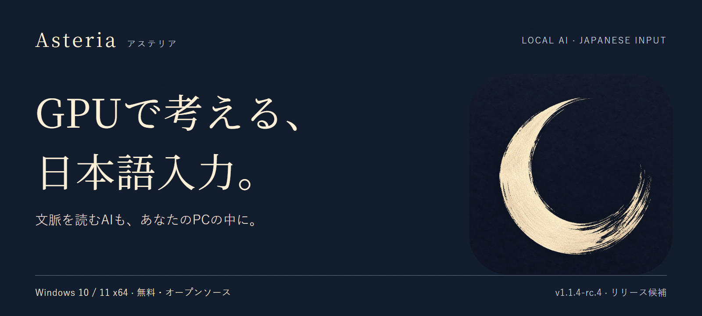

  

<h1 align="center">Asteria — アステリア</h1>

  <strong>文脈を読むAIも、あなたのPCの中に。</strong> 
  GPUで動くAIが候補を生成・採点する、Windows向けの日本語入力です。 
  入力した文章を外部サーバーへ送らず、オフラインで使えます。

  
  
  
  

<h2 align="center">
  <a href="https://github.com/aruiki/Asteria-Japanese-IME/releases/download/v1.1.4-rc.4/Asteria64.msi">↓ Windows版をダウンロード</a>
</h2>

  v1.1.4-rc.4 · リリース候補 · 2026-10-21公開 · 約1.66 GB · 未署名 
  <a href="docs/INSTALL.md">導入ガイド・SmartScreenの説明</a> ／
  <a href="https://github.com/aruiki/Asteria-Japanese-IME/releases/tag/v1.1.4-rc.4">更新内容・SHA-256</a>

## 言葉を選ぶ。その手がかりは、文脈。

文章のつながりから、同じ読みの候補を選び分ける。Asteriaは、Mozcの辞書・文節処理・学習を基盤に、ローカルAIによる候補の生成と評価を組み合わせています。

| 毎日の入力で | Asteriaがすること |
| --- | --- |
| 文章を書く | 確定した文章などの短い文脈を手がかりに、候補を生成・採点します |
| 続きを入力する | AIの予測候補をTabで選べます |
| いつもの言葉を使う | Mozcの候補操作、学習、ユーザー辞書を利用できます |
| 通信せずに使う | 辞書・AIモデル・実行環境を同梱。変換のためのアカウントや外部APIは不要です |

## 実際の入力を見る

  

実際に入力・変換した録画です。RC4の全機能・全アプリの動作を保証する動画ではありません。

## AIが考えている間も、書き進める

通常のAI経路では、**最初の生成・採点結果ができてから候補を表示**します。AIの準備中も読みの表示・編集・取消を続けられます。モデルの読み込みと推論は非同期で進みます。

Spaceで変換を求め、Enterで確定。その後に続けて打った文字も、順番を保って処理します。AIを切った場合やAIが実行できない場合には、Mozcによる入力を継続します。候補が出るまでの時間は、PCの性能・読みの長さ・モデルの準備状態で変わります。

[AI主体の候補表示の設計](docs/adr/0067-ai-first-candidate-publication.md) ／ [固定ソースでの検証](docs/verification/ai-first-publication-20261019.md)

## カタカナから、英語の表記へ

日本語の候補と一緒に、英語の綴りも選べます。追加辞書のインポートや、入力モードの切り替えは不要です。

| 入力 | 英語候補 |
| --- | --- |
| アーキテクチャ | architecture |
| アクセシビリティ | accessibility |
| コンフィギュレーション | configuration |
| レストラン | restaurant |

31,068の読み・36,402組の英語表記を収録しています。

## 3ステップで使い始める

1. [Asteria64.msiをダウンロード](https://github.com/aruiki/Asteria-Japanese-IME/releases/download/v1.1.4-rc.4/Asteria64.msi)します。
2. MSIを開いてインストールします。管理者の確認が表示されます。
3. **Windows + Space → Asteria日本語入力**を選びます。設定はデスクトップやスタートメニューの「Asteria」から開けます。

未署名のため、SmartScreenが表示される場合があります。公式配布元を確認したうえで進める手順を[導入ガイド](docs/INSTALL.md#smartscreenが表示されたとき)にまとめています。OSから再起動を求められた場合は、その案内に従ってください。

### 動作環境

| 項目 | 条件 |
| --- | --- |
| OS | Windows 10 1809以降 / Windows 11・64bit |
| メモリ | 8 GB以上、16 GB推奨 |
| GPU AI | Vulkan対応の専用GPU、VRAM 3 GiB以上。NVIDIA / AMD / Intel Arc |
| GPUがないPC | CPU向けのLow設定で動作。GPUのStandardと同じ品質・速度ではありません |
| ディスク | インストールに約1.7 GBの空き容量 |

内蔵GPUはAIに使用しません。モデル・実行環境はMSIに含まれ、PythonやCUDAの手動セットアップは不要です。10分間入力がなければ、GPU上のAIモデルを外してVRAMを解放します。

## 品質を、条件と一緒に公開する

開発用の固定変換器によるAJIMEE-Bench 200問のオフライン評価では、Standard・AI準備後・指定した前文ありで **188/200（94.0%）**。前文なしでは175/200（87.5%）でした。RC4に対応する固定ソースでも、第一候補の正解数を維持しています。

この値は調整・回帰用データでの結果です。起動直後や導入済みIMEの実アプリ精度、他IMEとの最新比較を示す値ではありません。

評価条件と、辞書・連語の改善例を見る

| AJIMEE-Benchの条件 | 正解数 |
| --- | ---: |
| Standard・AI準備後・前文あり | 188 / 200（94.0%） |
| Standard・AI準備後・前文なし | 175 / 200（87.5%） |
| AIなし・前文なし（Mozc＋追加連語） | 103 / 200（51.5%） |

StandardはRTX 3060で測定。指定した文脈を渡したオフライン評価です。

追加連語の変更前後をAIなし・前文なしで比べると、日常81問は65→69問正解（改善4問・改悪0問）でした。

| 読み | 変更前 | 変更後 |
| --- | --- | --- |
| あめがふってきた | 雨が振ってきた | 雨が降ってきた |
| じかんをはかる | 時間を図る | 時間を計る |
| たいじゅうをはかる | 体重を図る | 体重を量る |
| あついほん | 暑い本 | 厚い本 |

この4例はAIの効果を示す比較ではありません。[測定条件・図表・固定ソース](docs/BENCHMARKS.md)、[追加連語の検証](docs/verification/accuracy-usage-collocations-20261018.md)を参照してください。

RC4はリリース候補です。同じMSIの導入・入力・削除と、EDIT/RichEditでの候補操作8項目を確認しています。実アプリでのGPU AI ON/OFF寄与、複数アプリ、低性能実機、保護欄内部、旧版からの更新、再起動、独立した製品完成判定は未検証です。

[RC4の公開・検証記録](docs/verification/release-v1.1.4-rc.4-20261021.md) ／ [評価方法とデータ](eval/README.md) ／ [過去の実入力比較](docs/BENCHMARKS.md#過去の実入力比較)

## 使い方・応援・開発

- [使い方と困ったとき](docs/USER_GUIDE.md) — キー操作、更新、アンインストール、データの保存場所
- [不具合・誤変換・要望を報告](https://github.com/aruiki/Asteria-Japanese-IME/issues/new/choose)
- [紹介・告知用の画像と文章](docs/marketing/README.md)
- [Stripeから開発を支援](https://buy.stripe.com/cNi14m7jRdq005f0781ZS08) — 支援の有無による機能制限はありません
- [開発方法](docs/DEVELOPMENT.md) ／ [設計記録](docs/adr/) ／ [仕様](docs/SPEC.md) ／ [開発規約](AGENTS.md)

Asteriaは無料のオープンソースソフトウェアです。コードはApache License 2.0 / MIT License、Mozcへの変更はBSD-3-Clause。同梱コンポーネントを含む[ライセンス](docs/licenses.md)と[セキュリティ方針](SECURITY.md)を公開しています。

<h2 align="center">
  <a href="https://github.com/aruiki/Asteria-Japanese-IME/releases/download/v1.1.4-rc.4/Asteria64.msi">↓ Asteriaを試す</a>
</h2>

GPUで動くAI · 文章はPCの中に · Windows 10 / 11・64bit

