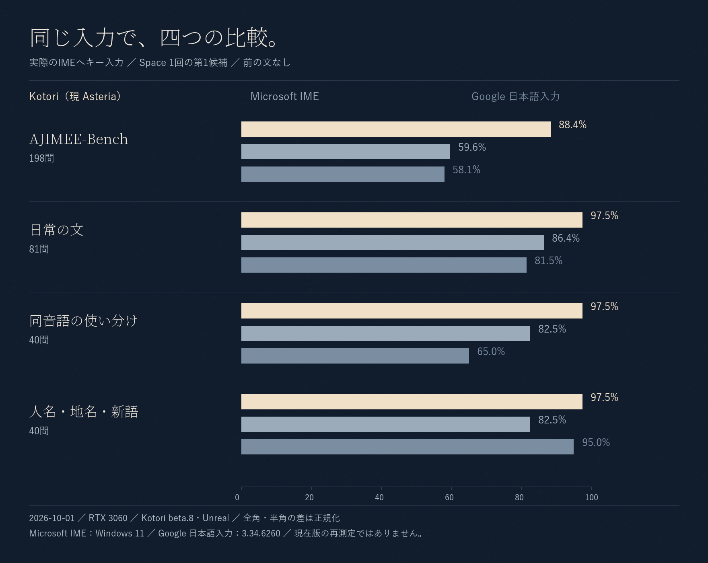

# 変換精度と入力応答（2026-10-19更新）

現在の掲載値は **Asteria v1.1.4 RC**の測定です。正式版v1.1.3とは別です。[RC1を公開済み](https://github.com/aruiki/Asteria-Japanese-IME/releases/tag/v1.1.4-rc.1)。旧Kotori時代の実入力比較は、下の過去資料へ分けています。

## 開発版の変換精度

Standard・AI準備後・指定した前文ありで、AJIMEE-Bench 200問中188問正解、**94.0%**。前文なしは175/200、87.5%です。固定変換器を直接実行したオフライン評価です。

| 評価セット | AIなし・前文なし | Standard・前文なし | Standard・前文あり |
| --- | ---: | ---: | ---: |
| AJIMEE-Bench | 103/200（51.5%） | 175/200（87.5%） | 188/200（94.0%） |
| 日常の文 | 69/81（85.2%） | 79/81（97.5%） | 79/81（97.5%） |
| 慣用句 | 22/25（88.0%） | 24/25（96.0%） | 24/25（96.0%） |
| ニュアンス | 11/20（55.0%） | 17/20（85.0%） | 17/20（85.0%） |

- StandardはRTX 3060でAIの準備を終えて測定。AIなしは本開発版のMozc＋追加連語で、素のMozcとは異なります。
- 前文ありは評価データに指定した短い文脈を渡した条件です。通常利用で常に同じ文脈が得られるとは限りません。
- 四つのセットは調整・回帰用です。独立した最終評価や、初回即Space・実アプリの精度を示す値ではありません。
- High/Unreal/Lowや他IMEについて、この版と同条件の最新測定はありません。旧結果から補間しません。

測定ソースは`8439fc26f21a90aa80c4cd694d57ca2f852ad658`、converter SHA-256は`4199d8d6dbad67bf90c60de011d18e18c49b62214c96006f8e8575d5e9228f8e`。後続のローカル6432候補は版番号、その後はモデル公開状態のmetadataだけの変更です。測定済みバイナリの識別を維持しています。

固定正解数・出典と原票SHAは[図版用データ](images/evaluation-2026-10-19.json)、手順と検証範囲は[通常変換の検証](verification/accuracy-normal-conversion-20261019.md)と[評価方法](../eval/README.md)を参照してください。

## 日常の変換例

追加連語の変更前後で、AIなし・前文なしの日常81問は65→69正解。改善4問・改悪0問でした。

| 読み | 変更前 | 開発版 |
| --- | --- | --- |
| あめがふってきた | 雨が振ってきた | 雨が降ってきた |
| じかんをはかる | 時間を図る | 時間を計る |
| たいじゅうをはかる | 体重を図る | 体重を量る |
| あついほん | 暑い本 | 厚い本 |

代表例だけで全体の品質を判断せず、上の全件正解数も併記しています。[用例連語の検証](verification/accuracy-usage-collocations-20261018.md)。初回「あいであきょく」→「アイデア局」の既知課題も残っています。

## 入力応答

同じ固定バイナリのWindows SessionHandlerを使い、CPU・GPUで各30シナリオを検査しました。新規プロセス・プロファイルでの起動直後15件と、AI準備後15件を含みます。文字欠落や確定差分などの検出不具合は両方0件でした。

| 実行条件 | キー応答の最大 | Space応答の最大 | シナリオ |
| --- | ---: | ---: | ---: |
| CPU | 1.94 ms | 516.13 ms | 30/30成功 |
| GPU（RTX 3060） | 2.76 ms | 230.67 ms | 30/30成功 |

時間は小数第2位へ四捨五入。これは実アプリのTSF測定ではなく、低性能PCの実機検証や旧版との速度比較も未実施です。機器・入力・準備状態で待ち時間は変わります。原票は`target/accuracy-guide/normal-lifecycle-cold-{cpu,gpu}-v1/summary.json`、[固定ソースと検査結果](verification/accuracy-normal-conversion-20261019.md)を参照してください。

## 過去の実入力比較

以下は **2026-10-01の旧Kotori beta.8・Unreal**を実際に各IMEへ入力した比較です。AJIMEE-Bench **198問**、前文なし、Space 1回の第1候補を使用。上のオフライン200問評価と異なる条件であり、Asteriaの最新値94.0%をこの比較へ置き換えることはできません。

| 当時のIME | 当時の正解率 |
| --- | ---: |
| Kotori beta.8・Unreal | 88.4% |
| Microsoft IME（Windows 11） | 59.6% |
| Google 日本語入力 3.34.6260 | 58.1% |

測定環境はRTX 3060、全角・半角の差は正規化。当時の[CSV](../eval/imebench/comparison-2026-10-01.csv)と[実入力比較の手順](../eval/imebench/README.md)を保存しています。他IMEを含む最新の実入力比較は未実施です。
