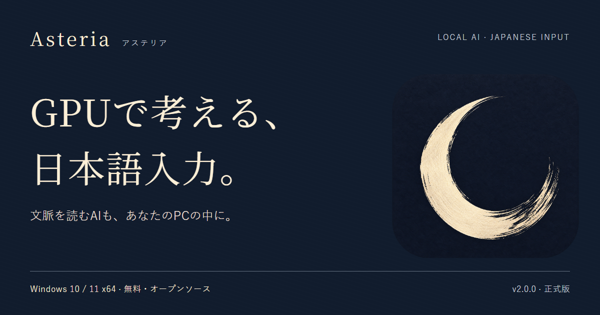

# Asteriaの紹介・告知素材

**GPUで考える、日本語入力。**  
文脈を読むAIも、あなたのPCの中に。

2026-10-21の正式v2.0.0公開に対応。採用済みの「月の余白」のブランドを引き継ぎ、累積したAI変換の更新と、保留確定時の表示残留修正を案内します。製品の実装・MSIの検証は[公開記録](../verification/release-v2.0.0-20261021.md)へ。

## そのまま使える素材

| 素材 | 用途 |
| --- | --- |
| [横長画像](assets/social.png)・1200×630 | SNS・ブログ・記事の紹介画像 |
| [縦長画像](assets/portrait.png)・1080×1350 | スマートフォン向け告知 |
| [READMEヒーロー](assets/hero.png)・1600×720 | リポジトリの紹介 |
| [短文・長文の告知コピー](announcements.md) | SNS・ブログ・配布先の紹介文 |
| [現行Release本文](release-copy.md) | v2.0.0の紹介・更新内容・導入案内 |
| [導入ガイド](../INSTALL.md) | 未署名・SmartScreen・SHA-256の説明 |

画像だけを転載する場合も、**v2.0.0は正式版**と分かる文面と[配布ページ](https://github.com/aruiki/Asteria-Japanese-IME/releases/tag/v2.0.0)へのリンクを添えてください。配布MSIは未署名です。

## コピーの軸

「文章を書く」「通信せずに使う」「いつもの操作で使い始める」の順に説明します。GPU AIが主役であることと、GPUがない場合のCPU向け動作を分けて伝えます。

94.0%を単独の広告見出しにしません。数値を引用する際は、Standard・AI準備後・前文あり・オフライン200問・RTX 3060という条件と[測定の説明](../BENCHMARKS.md)を添えます。[主張と出典](claims.md)。

## 制作と再利用

- 元の月ロゴは[採用済みのブランド素材](../design/2026-10-asteria/asteria-icon.png)をそのまま使用。製品アイコンや設定画面は変更していません。
- 文字とレイアウトは[creative.html](creative.html)で管理し、[render.mjs](render.mjs)でPNGへ描画します。月は既存素材で、実画面を模した図ではありません。
- `npm install --no-save playwright` の後、`node docs/marketing/render.mjs`。Chromiumの初回導入が必要な環境では `npx playwright install chromium`。Noto Serif JP / Yu Gothicが入ったWindowsで生成しています。
- インストール済みEdgeを使う場合は環境変数 `ASTERIA_RENDER_CHANNEL=msedge`。任意のNodeパッケージ置き場を使う場合は `ASTERIA_RENDER_MODULE_ROOT` にpackage.jsonがあるディレクトリを指定します。
- `?format=hero`、`?format=social`、`?format=portrait`で各アートボードを表示できます。これは画像制作の原稿で、公開Webサイトではありません。
- 既存の実入力GIFは撮影済みの記録を保持しています。今回、v2.0.0の新しい実アプリ動画を撮影したとは扱いません。

添付していただいた紹介文の、大きなダウンロード案内、Windows対応・オフライン表示、公式配布元の確認、SmartScreenの説明、変更履歴を取り込みました。旧v1.1.1〜v1.1.3の変更内容は当時の履歴として[Releases](https://github.com/aruiki/Asteria-Japanese-IME/releases)へ案内し、v2.0.0の新機能として再掲していません。今回の案内はv2.0.0の明示URLに統一し、GitHubのLatestも同じ正式版へ揃えています。

直前の紹介刷新での生成・リンク・画面と、当時の本体不変の確認は[過去の検証記録](../verification/marketing-refresh-20261021.md)へ。今回の修正・再ビルド・正式公開は[v2.0.0公開記録](../verification/release-v2.0.0-20261021.md)を参照してください。
