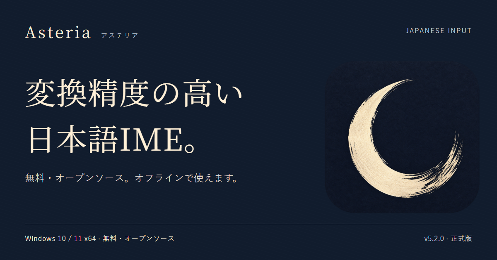

# Asteriaの紹介・告知素材

**変換精度の高い日本語IME。**

無料・オープンソース。オフラインで使えます。

2026-11-11の正式v5.2.0公開に対応(入力モードの保持、パスワード欄の保護、AI の準備の短縮、NVIDIA 向け追加パッケージ、今の版での精度の測り直し)。紹介画像(hero・social・portrait)の版の表記も v5.2.0 にした。

## そのまま使える素材

| 素材 | 用途 |
| --- | --- |
| [横長画像](assets/social.png)・1200×630 | SNS・ブログ・記事の紹介画像 |
| [縦長画像](assets/portrait.png)・1080×1350 | スマートフォン向け告知 |
| [READMEヒーロー](assets/hero.png)・1600×720 | リポジトリの紹介 |
| [短文・長文の告知コピー](announcements.md) | v5.2.0 の SNS・ブログ・配布先の紹介文 |
| [現行Release本文](release-copy.md) | Release の本文の置き場(mozc/release-notes.md) |
| [紹介動画](assets/asteria-v3-promo.mp4) | 39 秒。比較グラフと設定画面は 2026-11-11 に更新([記録](../verification/promo-graph-20261111.md)) |
| [導入ガイド](../INSTALL.md) | 未署名・SmartScreen・SHA-256の説明 |

画像だけを転載する場合も、v5.2.0 の[配布ページ](https://github.com/aruiki/Asteria-Japanese-IME/releases/tag/v5.2.0)へのリンクを添えてください。配布MSIは未署名です。

## コピーの軸

2026-10-22の利用者指定に従い、中心に置く価値は「変換精度の高い日本語IME」です。GPU・AI・文脈処理は実現手段として説明します。短い入力の辞書対策は開発中であり、未採用の辞書実験を公開版の改善として紹介しません。動作環境ではGPU用設定とCPU向けLowを分けて伝えます。

数値を引用する際は、[主張と出典](claims.md)の条件(同じ PC・同じ打ち方の実入力、測った版と日付)を添えます。

## 制作と再利用

- 元の月ロゴは[採用済みのブランド素材](../design/2026-10-asteria/asteria-icon.png)をそのまま使用。製品アイコンや設定画面は変更していません。
- 文字とレイアウトは[creative.html](creative.html)で管理し、[render.mjs](render.mjs)でPNGへ描画します。月は既存素材で、実画面を模した図ではありません。
- `npm install --no-save playwright` の後、`node docs/marketing/render.mjs`。Chromiumの初回導入が必要な環境では `npx playwright install chromium`。Noto Serif JP / Yu Gothicが入ったWindowsで生成しています。
- インストール済みEdgeを使う場合は環境変数 `ASTERIA_RENDER_CHANNEL=msedge`。任意のNodeパッケージ置き場を使う場合は `ASTERIA_RENDER_MODULE_ROOT` にpackage.jsonがあるディレクトリを指定します。
- `?format=hero`、`?format=social`、`?format=portrait`で各アートボードを表示できます。これは画像制作の原稿で、公開Webサイトではありません。
- 紹介動画とREADMEのGIFは実際の入力の録画。2026-11-11に比較グラフと設定画面の場面だけを差し替えた([記録](../verification/promo-graph-20261111.md))。

