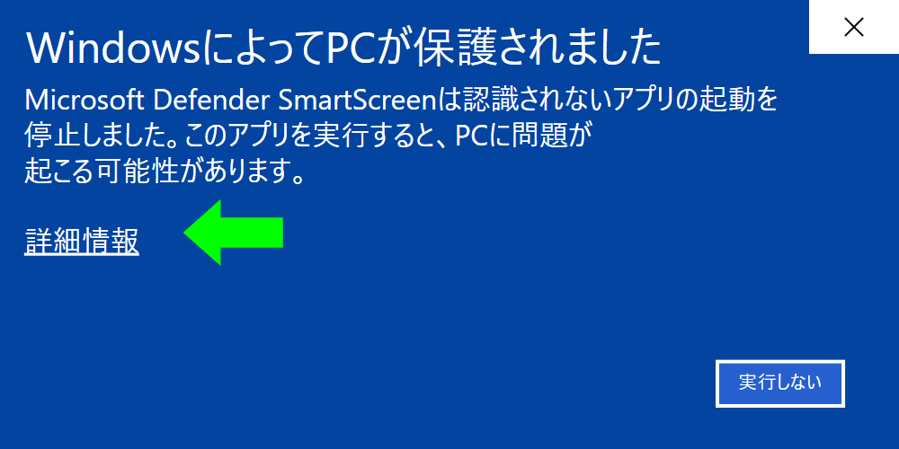
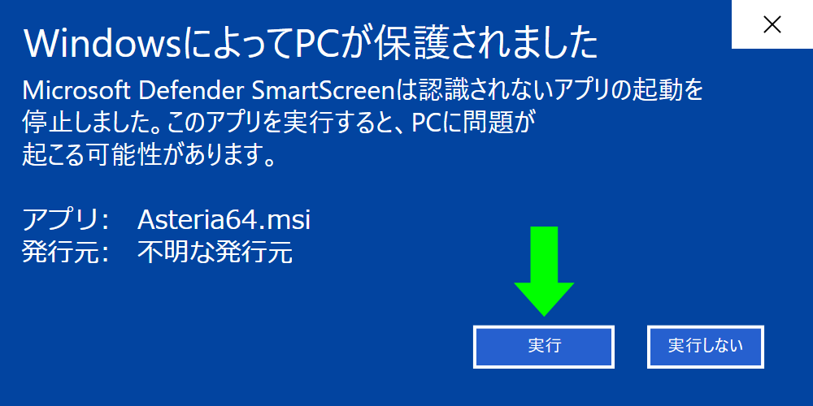

<h2 align="center">
  <a href="https://github.com/aruiki/Asteria-Japanese-IME/releases/download/v5.2.0/Asteria-5.2.0-x64.msi">
    ⬇ Asteria-5.2.0-x64.msi をダウンロード
  </a>
</h2>

  <strong>Windows 10 / 11・64bit</strong>　·　約1.7 GB　·　無料・オープンソース

  
  
  
  

## v5.2.0 で変わったこと

- **アプリや入力欄を移っても、日本語入力のオン・オフが英字に戻らなくなりました。** これまでは、別のアプリや入力欄に
  移ると、Windows やアプリが入力モードを英字に戻すことがありました。最後に自分で切り替えたモード(オン・オフ、ひらがな・
  カタカナ)を、すべてのアプリで、入力欄にフォーカスがないときも保ちます。半角/全角キーで切り替えた場合も同じです。
  パスワード欄では Windows に任せ、欄を出ると元のモードに戻ります。設定「入力の補助 → 入力モードをすべてのアプリで共有する」
  (既定オン)で止められます。
- **パスワード欄では AI と学習を止めるようにしました。** 以前はパスワード欄で日本語入力にすると、AI の変換・予測と
  学習(入力履歴・文節の区切り)が止まっていませんでした。導入した MSI で、パスワード欄の変換が数えられないことを確かめています。
- **AI の準備が速くなりました。** 起動のたびにモデル全体(約 1.4 GB)を検査していたのをやめ、AI が使えるまでの時間を
  10.6 → 3.9 秒(モデルのファイルがまだ読み込まれていないとき)、1.7 → 0.9 秒(2 回目以降)にしました。変換の速さと精度は変わりません。
- **NVIDIA の GPU 向けの追加パッケージ(任意)を用意しました。** 本体を入れたあとに `AsteriaCuda64.msi` を入れると、
  AI の計算に CUDA を使い、Space の変換が速くなります(RTX 3060 で中央値 185 → 137 ミリ秒、遅い方から 5% 目 262 → 199 ミリ秒)。
  入れなくてもこれまでどおり動きます。仮名と漢字の書き分けで 1 番目が変わる語が少しあります(ユリ／百合 など、
  調整に使っていない評価で 300 問中 228 → 226 問、日常の文で 81 問中 78 → 79 問)。止めるときは追加パッケージだけを
  アンインストールします。ダウンロードは約 0.5 GB(入れると約 0.7 GB)で、NVIDIA の CUDA の実行時ライブラリを含みます。
- **誤変換をこの PC に残せるようにしました(既定オフ)。** 設定「プライバシー → 誤変換の報告」をオンにすると、直近 20 件の
  読み・前の文・候補・確定した語をこの PC に残し、設定画面から確認・書き出し・消去できます。外へは送りません。
  パスワード欄とシークレットでは残しません。
- **精度を今の版で測り直しました**(同じ PC で実際に入力、Google日本語入力 3.34.6260 と比較)。前の文で正解が決まる
  同音語 300 問で Asteria 91%・Google 45%、日常の短文 500 問(表記ゆれは同じとみなす)で 95%・87%。
  [測り方と全結果](https://github.com/aruiki/Asteria-Japanese-IME/blob/main/docs/verification/accuracy-realinput-20261111.md)。
- 確かめたアプリ: メモ帳と、テスト用の入力欄(普通の欄・パスワード欄)。Word などの Office では、まだ確かめていません。

## v5.1.0 で変わったこと

- **品質「High」「Unreal」を選べるようにしました。** 設定画面の「AI 変換」から追加の AI をダウンロードすると選べます。
  High は GPU のメモリ 6 GB 以上(Llama 3.1 Swallow 8B の軽量版、約 4.0 GB)、Unreal は 8 GB 以上(同じ AI の標準版、
  約 4.9 GB)です。いつもの AI が決めた答えのうち、意味の選び分けで迷った
  ところ(熱い本／厚い本、自信／地震 など)だけを、より大きな AI が読み直します。調整に使っていない前の文で決まる同音語の
  選び分けで 297 問中 225 → 228 問、普段の文で 81 問中 78 → 81 問。ほかの評価で下がったものはありません。待ちはほとんど
  変わりません(数値は Unreal。High は 297 問中 229 問、81 問中 81 問)。受け取るときも、打った文字は送りません。
- **1 回目の変換だけ外れる不具合を直しました。** 以前の版(Kotori を含む)で覚えた文節の区切りが、AI の選んだ文を
  昔の区切りで切り直していました(例: くうかんこうへんちょうき → 1 回目は「空間後編長期」、2 回目は「空間光変調器」)。
  AI がオンのときは、覚えた区切りで AI の答えを崩さないようにしました。
- **同じ読みなら、Space を押す早さに関係なく同じ答えを出すようにしました。** 打ってすぐ押す・少し待ってから押す・
  もう一度押す・前の版の学習が残っている、のどの場合も同じ 1 番目になることを確かめました(88 問中 86 → 88 問)。
  打ち間違いは、すぐ Space を押しても直るようになりました(40 問中 22 → 28 問)。
- **AI の計算が混んでも、Mozc の答えに戻さないようにしました。** ほかのアプリが GPU を使っていて時間がかかったときも、
  そこまでに AI が選んだ答えを出します。
- **変換候補の 2 番目以降を整理しました**(Issue #208)。「波る」「ヤブれて」のような辞書にない作文は出さず、
  語の組み合わせ(返品好感 など)は普段の候補の後ろに回しました。AI がよいと見た辞書の語(直ったのか など)は 2 番目から
  並びます。カタカナ語の英語表記(night など)は一覧の後ろにし、設定「カタカナ語を英語に」で止められます。
- 「ないと」のような短い語を、打ち間違いとして別の語(ライト)に直さないようにしました。
- 設定画面で追加の AI を消したとき、画面が「入っています」のまま変わらず、「消しました」も出なかった不具合を直しました
  (ファイルは消えていました)。設定画面の「AI の状態」には、High・Unreal の判定役が動いているかも出るようにしました。
- 入力中に文を丸ごと作り直す補正をやめました。正解は増えず、Space の待ちを延ばしていたためです
  (前の文で決まる同音語の選び分けで、待ちの長い方から 5% が 0.09 → 0.04 秒)。打ち間違いの補正は続けます。
- 精度は前と同じです(調整に使っていない文脈の選択で 297 問中 225 問、短文で 120 問中 119 問)。
- 配布ファイルの名前に版を入れました(Asteria-5.1.0-x64.msi)。中身が同じ Asteria64.msi も、これまでのリンクのために添付します。
  旧名の Kotori64.msi の添付はやめました。
- 確かめたアプリ: メモ帳と Edge。Word などの Office では、まだ確かめていません。

## v5.0.0 で変わったこと

- **変換の AI を、より正確な genmai に替えました。** 調整に使っていない普段使いの文で 120 文中 116 → 118 文、
  前の文で正解が決まる同音語の選び分けで 297 問中 214 → 225 問になりました。変換の待ちはほぼ同じです。
- **設定画面を作り直しました。** 変えた設定はすぐ保存され、左の一覧と検索で項目を探せます。明るい・暗いの配色は
  Windows に合わせます(Edge の表示部品 WebView2 を使います。入っていない PC では以前の画面が開きます)。
- **新しい「Eco」モード。** 小さい AI だけで動き、GPU のメモリと電気を節約します。ノート PC の電池を持たせたいときや
  ゲーム中に。いつもの精度で使うなら、これまでどおり Standard(既定)のままで大丈夫です。
- 大きい追加の AI を設定画面からダウンロードする仕組みを入れました。今回試した大きい AI(Qwen3-4B・Qwen3-8B・
  sarashina2.2-3b)はどれも Standard を上回らなかったので、High・Unreal はまだ選べません。上回るものが見つかったら、
  ダウンロードして選べるようにします。受け取るときも、打った文字は送りません。
- 以前 High・Unreal を選んでいた人は、Standard と同じ動きになります。
- 打ち間違いの補正は、手を止めてすぐ Space を押したときに少しだけ直りにくくなりました(40 問中 24 → 22 問。
  少し待てば前より直ります)。
- 確かめたアプリ: メモ帳と Edge。Word などの Office では、まだ確かめていません。

## v4.2.0 で変わったこと

- **打っている途中に出る窓を、続きの予測だけにしました**（Issue #205）。これまでは手を止めるたびに窓が出ていました。
  これからは、打った読みの続きになる言葉があるときだけ出します（例：ありがと → ありがとうございます）。予測は AI を待たずに
  すぐ出ます。変換した結果は、これまでどおり Space で見られます（打ちながら見たい人はライブ変換を使えます）。
  裏で進める AI の準備と打ち間違いの補正は、窓の設定に関係なく今までどおり働きます。
  設定の「予測」で、予測の元（入力履歴・辞書）、候補の数、予測を出し始める文字数（最初は 3 文字）を選べます。
- **同じ間違いを二度しないようにしました。** 選び直して確定した文は、次に同じ文を打ったとき、その文で出ます。
  覚えた内容はこの PC の中だけに置き、「学習履歴のクリア」で消えます。
- **英字は、まだ選んでいなければ半角で出すようにしました**（生成ＡＩ → 生成AI、Ｐｙｔｈｏｎ → Python）。一度選んだ書き方は
  覚えて次から使います。数字と記号はこれまでどおりです。
- **濁点の付け忘れも直すようにしました**（ありがとうごさいます → ありがとうございます）。
- **設定画面を作り直しました。** 左の一覧と検索で項目を探せます。各項目に、何が変わるのかの説明と例を付けました。
- **応援のお願いの通知が、一度も出ていなかった不具合を直しました。**
- 精度：調整に使っていない普段使いの文で、120 文中 115 → 117 文。ほかの評価で前より悪くなった問題はありません。
- 確かめたアプリ：メモ帳と Edge。Word などの Office では、まだ確かめていません。

## v4.1.0 で変わったこと

- **英語の名前をローマ字のまま打てるようにしました**（設定でオン。最初はオフ）。日本語と英語を切り替えずに
  「github」「linux」「ubuntu」と打って Space を押すと、文に合えば「GitHub」「Linux」「Ubuntu」になります
  （例：ubuntuwoirete → Ubuntuを入れて）。「sake → 酒」のように日本語の語として読める綴りは変えません。
  評価に使った日本語の文（約 470 文）で、英語に変わってしまった文はありませんでした。Caps Lock がオンでも働きます。
- **設定画面の「AI 変換」タブをスクロールできるようにしました。** 画面の高さが小さいと、「適用」「OK」が画面の外に出ていました。

## v4.0.0 で変わったこと

精度の高い変換はそのままに、**好みでオンにできる新しい機能**を加えました。どれも最初はオフで、設定の
「AI 変換」タブでオンにできます。オフのままなら、これまでと同じように動きます。

- **ライブ変換**：打っている途中で、手が止まると AI が変換した文字に入れ替わります。Enter でそのまま確定し、
  Space で候補を選べます。表示される文字は、Space を押したときの 1 番目と同じです。
- **同音語のヒント**：「足」と「脚」のように同じ読みの語が候補に並ぶとき、「靴・靴下」「椅子・机」のような
  見分けるための手がかりを候補の横に出します。
- **内蔵 GPU で AI を動かす（試験的）**：専用の GPU がない PC で、CPU の代わりに内蔵 GPU を使います。
  開発者の手元に内蔵 GPU の PC がなく、**速さと安定はまだ確かめていません**。反映には PC の再起動が必要です。
- **打ち間違いの補正の決め方を見直しました。** 例に合わせて足した決まりをやめ、「そのキーを打ち間違える確率」と
  「その文になる確率」から、十分に確かなときだけ直すようにしました。これまでの評価の文で、正解数は変わりません。

> [!NOTE]
> `Asteria64.msi` の実行時に Microsoft Defender SmartScreen の 
> **「WindowsによってPCが保護されました」**
> という画面が表示される場合があります。下の手順で続けられます。

---

## インストールの流れ

1. 上の **Asteria64.msi** をダウンロードして開きます。
2. SmartScreen が出たら、**詳細情報 → 実行**（下の説明）。
3. **「インストール」**（入っている場合は「更新」）を押し、Windows の確認（UAC）を許可します。完了の画面が出たら終わりです。
4. **Windows + Space** で「Asteria日本語入力」を選ぶと使えます。

「開いているアプリを閉じてください」と求めることはありません。v3.0.0 以降の更新は再起動もいりません。
**v2.0.0 以前から更新したときだけ、最後に Windows を再起動してください**（再起動まで、更新前から開いていたアプリでは日本語に変換できません）。設定・学習・ユーザー辞書は引き継ぎます。

---

## SmartScreenが表示された場合

> [!IMPORTANT]
> このGitHub Releaseからダウンロードした
> **`Asteria64.msi`** であることを確認してください。

**1. <kbd>詳細情報</kbd> をクリック**

**2. アプリ名が `Asteria64.msi` であることを確かめて、<kbd>実行</kbd> をクリック**

これで通常のAsteriaインストーラーが起動します。
**SmartScreenやMicrosoft Defenderを無効にする必要はありません。**

### なぜこの警告が出るの？

SmartScreenは、ウイルスの検査だけでなく、ダウンロードしたアプリや発行元に
**Windows上で十分な「評判（reputation）」があるか**も見ています。
Asteriaのインストーラーはコード署名をしていないため、この画面が出ることがあります。

**「WindowsによってPCが保護されました」＝「マルウェアが検出された」ではありません。**
[Microsoft公式：SmartScreenの評判について](https://learn.microsoft.com/ja-jp/windows/apps/package-and-deploy/smartscreen-reputation)

<strong>安全性をさらに確認する</strong>

 

- [ソースコード](https://github.com/aruiki/Asteria-Japanese-IME)
- [Security Policy](https://github.com/aruiki/Asteria-Japanese-IME/security/policy)
- ファイルの照合: PowerShell で `Get-FileHash -Algorithm SHA256 .\Asteria64.msi` を実行し、添付の `Asteria64.msi.sha256` と同じか確かめます。

AsteriaのAIモデル・辞書・日本語変換はPCの中で動き、
**入力した文章をAsteriaのサーバーや外部AIサービスへ送信しません。**

> [!WARNING]
> SmartScreenの「認識されないアプリ」という警告ではなく、
> Microsoft Defenderなどから**具体的な脅威名やマルウェア名**が表示された場合は実行しないでください。

---

## 動作環境

- Windows 10 1809 以降 / Windows 11（64bit）、メモリ 8 GB 以上（16 GB 推奨）、ディスク約 1.7 GB
- AI は Vulkan 対応の専用 GPU（VRAM 3 GiB 以上）で動きます。GPU のない PC は CPU 向けの設定で動きます。

[使い方と紹介（README）](https://github.com/aruiki/Asteria-Japanese-IME#readme) ／ [不具合・誤変換を報告](https://github.com/aruiki/Asteria-Japanese-IME/issues/new/choose)
