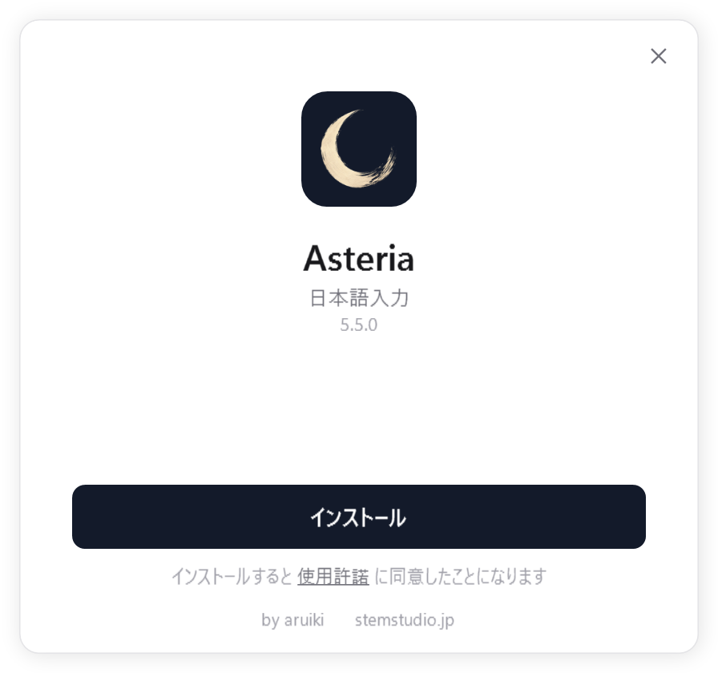
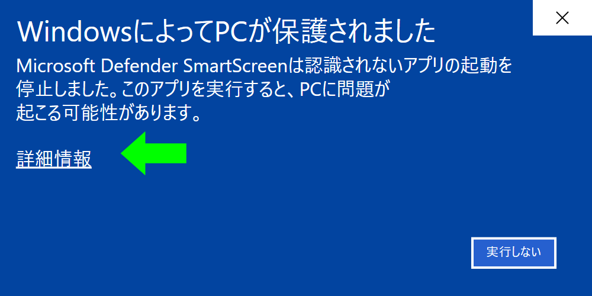
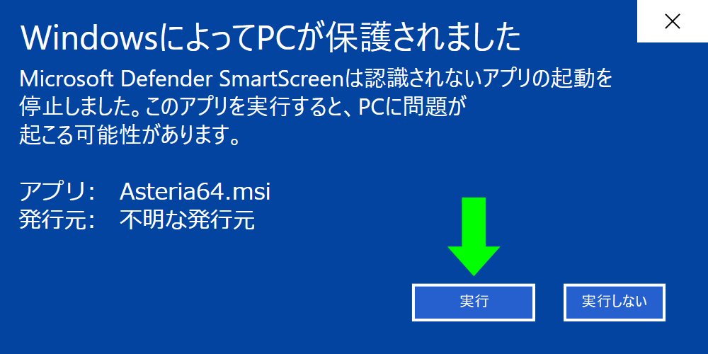

  

<h2 align="center">
  <a href="https://github.com/aruiki/Asteria-Japanese-IME/releases/download/v5.5.0/Asteria-Setup.exe">Asteria-Setup.exe をダウンロード</a>
</h2>

Windows 10 / 11（64bit）　約 2.1 GB　無料・オープンソース

---

## 5.5.0 で変わったこと

**インストーラーが 1 つになりました。** ダウンロードは `Asteria-Setup.exe` だけです。開いて「インストール」を押すと、
NVIDIA の GPU がある PC では、変換を速くする部品（CUDA）も自動で入ります。今までのように 2 つのファイルを入れ分ける必要はありません。

5.4.0 からの変換の速さ（Space を押してから候補が出るまで）も、そのまま引き継いでいます。

## インストール

1. 上の **Asteria-Setup.exe** を開きます。
2. 「WindowsによってPCが保護されました」と出たら、**詳細情報 → 実行**（下の説明）。
3. **インストール** を押し、Windows の確認（UAC）を許可します。
4. 終わったら **Windows + Space** で「Asteria日本語入力」を選びます。

前の版が入っていても、そのまま上書きできます。設定・学習・ユーザー辞書は引き継ぎます。

## 「WindowsによってPCが保護されました」と出たら

Asteria のインストーラーはコード署名をしていないため、Microsoft Defender SmartScreen がこの画面を出すことがあります。
ウイルスが見つかったという意味ではありません。

1. <kbd>詳細情報</kbd> を押します。

   

2. アプリ名が `Asteria-Setup.exe` であることを確かめて、<kbd>実行</kbd> を押します。

   

SmartScreen や Microsoft Defender を無効にする必要はありません。具体的な脅威名やマルウェア名が出た場合は、実行しないでください。
[SmartScreen の評判について（Microsoft）](https://learn.microsoft.com/ja-jp/windows/apps/package-and-deploy/smartscreen-reputation)

## 添付ファイル

| ファイル | 用途 |
| --- | --- |
| **Asteria-Setup.exe** | ふつうはこれだけ。本体と、NVIDIA の GPU 向けの高速化を中に持ち、PC に合わせて入れます |
| Asteria-5.5.0-x64.msi・Asteria64.msi | 本体だけの MSI（管理者の一括導入など） |
| AsteriaCuda64.msi | NVIDIA の GPU 向けの高速化だけ（本体の MSI の後に入れる） |
| `*.sha256` | 各ファイルの SHA-256 |

ファイルの照合: PowerShell で `Get-FileHash -Algorithm SHA256 .\Asteria-Setup.exe` を実行し、添付の
`Asteria-Setup.exe.sha256` と同じか確かめます。

## 動作環境

- Windows 10 1809 以降 / Windows 11（64bit）、メモリ 8 GB 以上（16 GB 推奨）、ディスク約 1.7 GB
- AI は Vulkan に対応した専用 GPU（VRAM 3 GB 以上）で動きます。GPU のない PC では CPU 向けの設定で動きます。

AI のモデル・辞書・変換はすべて PC の中で動き、入力した文章を外へ送りません。

[README](https://github.com/aruiki/Asteria-Japanese-IME#readme)　[ソースコード](https://github.com/aruiki/Asteria-Japanese-IME)　[不具合・誤変換の報告](https://github.com/aruiki/Asteria-Japanese-IME/issues/new/choose)
